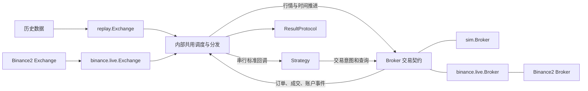
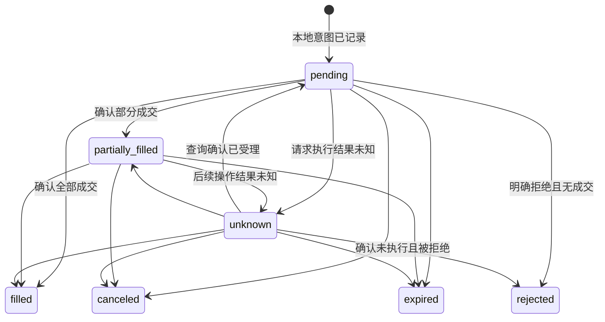

# 实时交易模块设计稿

日期：2026-10-23。版本：第五版，明确交易场所插件入口与自定义 Exchange/Broker 扩展边界。
状态：待实施的设计提案；本文中的新增接口尚不存在。

目标：基于 Binance2 的 Exchange/Broker 接入实时行情和交易，保留合理的 minbt 接口，
让同一份策略可以运行于历史回测、本地模拟盘、Binance demo 和实盘。
本次交付为设计文档，不实施交易代码。

## 1. 设计结论

定位为 **mini、低认知负荷**。用户只需理解三个核心概念，具体实现由模块区分，类名保持一致：

| 核心概念 | 用户理解 | 公共实现与职责 |
| --- | --- | --- |
| Exchange | 观察市场、运行交易过程 | `replay.Exchange` 回放历史；`live.Exchange` 接入实时行情；管理时钟、生命周期和事件交付 |
| Broker | 使用一个账户交易 | `sim.Broker` 模拟执行与账户；`live.Broker` 对接交易所账户，管理订单、成交、资金和恢复 |
| Strategy | 根据行情与账户事实作决策 | 同一个 `Strategy`，通过 `self.broker` 交易，通过 `self.exchange` 读取运行时间 |

本文的 `replay`、`sim` 来自 minbt 核心，`live` 来自 **`minbt.plugins.binance.live`**。
Binance 的 Exchange 与 Broker 都归属插件，不在核心提供默认指向 Binance 的 minbt.live。
其他交易场所或用户自定义实现放在各自模块中，沿用 Exchange、Broker 类名与通用契约。
选择实现靠 Python 显式导入和对象组合，核心不识别交易场所名称、不维护插件注册表。

统一调用 `exchange.run()`，不增加 run_live，不引入公共 Engine 概念。
两个 Exchange 实现分别负责历史与现实时间的推进，共用内部事件分发、生命周期保护和结果代码；
不会各自复制一整套运行框架。Feed、SDK 连接和内部会话是实现或高级扩展边界，不要求普通用户先学习。

同一个 `sim.Broker` 实现用于历史回测和实时模拟；`live.Broker` 用于 demo 和 mainnet 账户。
每次独立运行创建新实例，不共享上一场运行的可变账户或策略状态。
使用 `sim` 表示模拟执行，覆盖历史与实时；paper trading 仅作为实时模拟场景的解释，不成为公共模块名。
Strategy 无需写 is_backtest/is_live 分支。

行情与时间由 Exchange 负责，交易执行与账户事实由 Broker 负责。SDK 的 Exchange/Broker 都不会直接从后台线程
调用策略；经过 minbt Exchange 的串行分发后，Strategy 才看到标准化事件。

新版本默认采用事件驱动成交：任何交易环境下，提交返回都不承诺已成交，资金和仓位由确认事实更新。
模拟 Broker 默认在下一条可执行行情上撮合。旧同步成交只保留为显式
`execution="legacy_immediate"` 的历史复现实用选项，不继续作为默认，也不用于实时模拟。
这是有意的行为迁移，详见第 13 节；优先保证真实场景的一致性，不为维持旧假设增加运行入口。

一致性分为三层：

| 层次 | 承诺 |
| --- | --- |
| 策略与接口 | 回调签名、下单方法、数量方向、目标仓位含义、查询名称尽量相同 |
| 订单与事件 | 统一异步确认的调用契约、订单句柄、部分成交、成交明细、账户通知与非重入回调顺序 |
| 金融结果 | 同数据、同模拟参数可以复现；不同环境的流动性、费用、资金费、延迟、强平与实际收益不保证相同 |

不再以“函数已经返回”推断成交。依赖旧立即成交语义的策略迁移到 on_fill/on_account；
只根据行情计算目标、通过 Broker 表达意图的策略可以保持主体不变。

### 1.1 回测与实盘的区别能否全部放进 Broker

交易部分可以统一放进 Broker，运行时间不能仅由 Broker 推断。最直接的反例：
同一个模拟账户既可能消费一年的历史数据，也可能等待今晚的实时行情。
Broker 的模拟撮合行为相同，运行器的等待/结束规则不同。

| 差异 | 归属 | 原因 |
| --- | --- | --- |
| 本地撮合或交易所执行、滑点、延迟、部分成交 | Broker | 决定交易如何发生 |
| 虚拟资金或远端余额、保证金、资金费、订单恢复 | Broker | 决定账户事实来自哪里 |
| 历史数据读取或 WebSocket 行情、闭合 K 线收齐 | Exchange，通过内部数据适配完成 | 决定策略何时能观察到什么 |
| 快速推进虚拟时间或等待现实时间、无行情控制、最终排空 | replay.Exchange / live.Exchange | 由所选模块明确决定运行方式 |
| 把数据与账户配成一次回测或一次实盘 | 装配入口 | 调用者选对象，策略不选模式 |

用户在创建 Exchange 时选择历史或实时，在创建 Broker 时选择模拟账户或交易所账户。
Broker 不隐式下载数据、决定全局时钟或自己执行 Strategy。
这样将 `replay.Exchange` 换成 `live.Exchange` 后，仍能使用相同的 `sim.Broker` 和策略。

### 1.2 谁需要知道是否为真实交易

策略作者不需要知道：使用相同下单、查询和事件接口。
运行程序的人只需要理解“使用虚拟资金”或“使用哪个交易账户”，无需理解 paper-trade 等术语。
生产账户仍须在装配时明确选择，不能因发现 API Key 就从模拟自动切成实盘。
示例使用 `sim.Broker(...)` 或 `live.Broker(..., environment="demo"/"mainnet")`。
`live.Broker` 表示连接外部交易账户；是否使用真实资金由显式 environment 决定。
environment 必填，不额外增加 demo/paper/real 类名或构造入口。

## 2. 依据与依赖名称

用户提到 `finapi.binance2`。本地核查结果：相邻 `finapi` 当前没有该模块；具有所述类的代码位于
`crypto_api.binance2.usdm`，包版本为 `0.2.1`，检查提交为 `fbc4ab8`。
本文按这套已核实接口设计，未把两个包视为可直接互换。若实际部署使用另一个 finapi 分支，
需先核对下表能力和签名，再替换插件内部导入。

minbt 基准为 `0.1.1`、提交 `6c1e7a0` 及当前工作区。已有未提交的数值结算修复作为现状读取，
本稿不覆盖该工作。主要证据：

| 代码/文档 | 已确认事实及设计影响 |
| --- | --- |
| [Strategy](../../minbt/strategy.py) / [Broker 协议](../../minbt/protocols/broker.py) | 策略已按协议接收 Broker；无需把策略改成 SDK 回调或 async 函数 |
| [Exchange](../../minbt/exchange.py) | 当前仅支持有限历史流；增量模式会预读下一项，不能直接接无限阻塞迭代器 |
| [Broker](../../minbt/broker/broker.py) / [Order](../../minbt/broker/order.py) | 默认市价单同步成交；`qty` 和 `filled_qty` 都是有符号数量；目标单只按已成交仓位计算 |
| [结果冻结](../../minbt/result.py) / [结果协议](../../minbt/protocols/result.py) | 已支持协议型账户，但扩展 OrderSnapshot 字段时不能强制旧自定义订单提供新字段 |
| [Kline 适配](../../minbt/plugins/binance/kline.py) | 历史完整 K 线以 `close_time` 发布，实时需保持相同字段与可见时间 |
| [Binance2 Exchange](../../../crypto_api/crypto_api/binance2/usdm/exchange.py) | `on_data(list[MarketEvent])` 构造时绑定；批次按本地接受顺序交付，不是同一交易所时间截面 |
| [SDK 行情交付](../../../crypto_api/crypto_api/binance2/usdm/_delivery.py) | MarketEvent.received_at 在 SDK 发布入队时记录；stats 提供 oldest_pending_age，但不代表正在回调的批次年龄 |
| [Binance2 Broker](../../../crypto_api/crypto_api/binance2/usdm/broker.py) | 独立账户、REST 查询/交易、私有事件；自身不维护账户缓存 |
| [SDK 发送边界](../../../crypto_api/crypto_api/binance2/usdm/_adapters/sdk.py) | 请求内部可能等待限流；before_send 目前检查资源关闭，尚不能接收 minbt 的逐请求交易许可，实施时须补齐适配能力 |
| [Binance2 类型](../../../crypto_api/crypto_api/binance2/usdm/types.py) / [异常](../../../crypto_api/crypto_api/binance2/exceptions.py) | 原始金额是字符串；下单不接收 float；有结果未知异常和恢复标识 |
| [Exchange/Broker 指南](../../../crypto_api/docs/binance2/exchange-broker.md) | 条件单独立于普通单，无托管 OCO；重连不补历史；stop/close 不撤单或平仓 |
| [网络配置](../../../crypto_api/crypto_api/binance2/usdm/config.py) | 环境名称为 `mainnet` / `demo`，不使用未经实现的 `testnet=True` |

沿用 [小内核设计](kernel-20261012-protocol-plugins.md) 的组件独立性和
[运行控制设计](run-20261012-control.md) 的暂停/退出语义；公共模块划分、默认成交和初始化阶段按本稿修订。
当前已实施接口仍以源码为准，本稿仅定义下一版本目标。
核心保留策略、通用回放/模拟、协议、共用事件处理与结果；Binance 的连接、私有事件映射、账户恢复和持久化
归属 Binance 插件。核心不反向导入插件，不引入全局插件注册表。

## 3. 场景与首版范围

| 优先级 | 场景 | 用户操作 |
| --- | --- | --- |
| P0 | 历史回测 | replay.Exchange + sim.Broker，调用 exchange.run |
| P0 | 同一策略接真实行情进行本地模拟 | live.Exchange + sim.Broker，继续调用 exchange.run |
| P0 | demo 验证下单、部分成交、撤单与恢复 | live.Exchange + live.Broker，均配置 demo |
| P0 | 生产实盘 | live.Exchange + live.Broker，均配置 mainnet 及对应账户 |
| P0 | 连续计算目标仓位 | 避免上一笔未完成时重复开仓 |
| P0 | 暂停策略、退出本地进程 | 行情和账户同步继续；退出动作与撤单/平仓分开 |
| P0 | 断线、请求超时、重启 | 查询原单、对账、恢复保护，不重复发送未知请求 |
| P1 | 原有止盈止损迁移 | 本地退出语义复用；可选择交易所原生保护 |
| P2 | 多策略分仓、双向持仓和多账户 | 增加独立的账户归属与资金分配模型 |

首个完整实盘版本限定：**USDT 结算永续合约、单向持仓、全仓、单资产保证金、一个交易账户、
一个策略、`portfolio="main"`**。标的使用显式列表，不使用运行中变化的全市场通配订阅。
启动时从合约和账户配置验证这些约束，发现不支持的配置就失败，不自动修改账户模式。

本地回测和模拟盘继续保留现有多市场、分仓能力；实盘对尚未实现的分仓、双向持仓、跨币种估值
明确报 `UnsupportedCapabilityError`。保留方法名不等于承诺首版已实现每个金融模型。

四种运行场景通过对象组合表达：

| 运行方式 | 行情 | 执行与账户 |
| --- | --- | --- |
| 回测 | replay.Exchange，用户准备历史数据 | sim.Broker |
| 本地模拟盘 | live.Exchange，可使用 mainnet 公共行情 | 同一个 sim.Broker 实现，虚拟资金，无私有交易连接 |
| Binance demo | live.Exchange(environment="demo") | live.Broker(environment="demo") |
| 实盘 | live.Exchange(environment="mainnet") | live.Broker(environment="mainnet") |

demo 和实盘使用同一个适配器；本地模拟盘用于验证策略与模拟模型，demo 用于验证外部交易链路。

以下真实场景决定内部调度必须与交易方式分开：

- 市场暂时没有新行情，但挂单发生部分成交：Broker 事件仍立即交付，不能依附下一根 K 线。
- 模拟账户配实时行情：无需 API Key，但仍需要心跳、断线处理和长时间运行的历史限制。
- 历史行情配真实交易账户：普通 run 直接拒绝，不能把旧信号高速发送到今天的账户；demo 也同样拒绝该无明确时钟含义的组合。
- 历史数据播完而限价单仍未成交：按回测截止点保存未决订单并结束，不一直等待虚拟时间之外的行情。
- 真实账户已有仓位，进程重启：Broker 恢复交易事实，策略恢复计算状态，不能把实际余额重置成 initial_cash。
- 真实交易和模拟交易同时比对：未来可将同一行情广播给两个独立策略实例和各自 Broker；共享一个有状态策略对象会混淆账户事件，首版不开放。

## 4. 用户接口草案

以下代码展示拟新增接口，不是当前可运行示例。

### 4.1 保持同一策略

```python
from minbt import Strategy


class Trend(Strategy):
    def on_bars(self, dt, bars):
        bar = bars["BTCUSDT"]
        target = 0.2 if bar["close"] > bar["open"] else 0.0
        self.broker.order_target_percent("BTCUSDT", target)

    # 新增可选回调；基类默认空实现。
    def on_order(self, order):
        self.logger.info(f"订单 {order.id}: {order.status}")

    def on_fill(self, fill):
        self.logger.info(f"成交 {fill.order_id}: {fill.qty} @ {fill.price}")

    def on_account(self, account):
        self.logger.info(f"账户权益: {account.equity}")
```

`target_percent=0.2` 继续表示目标名义价值为账户权益的 20%，不因杠杆为 5 而自动乘 5。
负数仍表示净空头。需要 100% 名义敞口时传 `1.0`。

### 4.2 历史回测

```python
from minbt import replay, sim

broker = sim.Broker(initial_cash=10_000)
exchange = replay.Exchange()
exchange.set_bars(prepared_rows)
exchange.add_strategy(Trend("trend", broker=broker))
result = exchange.run()
```

模拟账户默认使用下一事件撮合；只在需要复现旧历史实验时显式选择：

```python
broker = sim.Broker(initial_cash=10_000, execution="legacy_immediate")
```

默认模型不使用提交时已经看到的行情成交；下一条满足执行价格条件的该标的事件才可成交。
仅有 1 分钟 K 线时可能在下一根收盘成交，这只是明确的简化模型。
想验证逐笔/报价驱动的执行，必须提供对应历史数据，不能用一根 OHLC 推断真实盘中顺序。

### 4.3 本地模拟盘

```python
from minbt import sim
from minbt.plugins.binance import live

exchange = live.Exchange(
    symbols=["BTCUSDT"],
    interval="1m",
    environment="mainnet",
)
broker = sim.Broker(initial_cash=10_000)
exchange.add_strategy(Trend("trend", broker=broker))
result = exchange.run(control=read_control)
```

`read_control()` 与现有接口相同，返回 `continue/pause/exit`，不要求用户管理线程或 asyncio。
示例使用 K 线执行价格，若需报价输入，可在启动前调用
`exchange.subscribe(["BTCUSDT"], "book_ticker")`，再显式选择执行价格配置，见第 7 节。
实时行情连接由 `live.Exchange` 管理，普通用法无需另建实时 Feed。

### 4.4 选择交易所账户

```python
import os
from minbt.plugins.binance import live

symbols = ["BTCUSDT"]
exchange = live.Exchange(
    symbols=symbols, interval="1m", environment="demo",
)
broker = live.Broker(
    api_key=os.environ["BINANCE_API_KEY"],
    api_secret=os.environ["BINANCE_API_SECRET"],
    environment="demo",
    symbols=symbols,
    account_id="trend-demo",
    state_dir=".minbt/trend-demo",
)
exchange.add_strategy(Trend("trend", broker=broker))
result = exchange.run(control=read_control)
```

此处 live 是 Binance 插件的实时模块，environment、symbols、API Key 等构造参数由插件定义，
不成为所有自定义 Exchange/Broker 都必须接受的核心参数。
使用真实资金时，将 Exchange 与 Broker 的 environment 均显式设为 `"mainnet"`，
使用对应凭证和独立状态目录。策略、add_strategy 和 run 完全相同。
不从密钥或名称猜测执行环境。live.Broker 的 `initial_cash` 来自启动对账后的实际账户，
不接收伪造的初始现金。`state_dir` 在首次启动时创建；构造和导入不联网、不下单。
密钥不写入配置快照、结果、状态日志或异常载荷。

### 4.5 拟定签名与生命周期

```text
replay.Exchange.run(
    *,
    start=None,
    end=None,
    control=None,
    load_mode="auto",
    history_limit="auto",
    result_dir=None,
) -> ResultProtocol

live.Exchange(
    *, symbols, interval, environment,
    closed_only=True,
    align_timeout=5.0,
    queue_size=10_000,
)

live.Exchange.run(
    *,
    end=None,
    control=None,
    poll_interval=0.2,
    shutdown_timeout=10.0,
    history_limit="auto",
    result_dir=None,
) -> ResultProtocol

live.Broker(
    *, api_key, api_secret, environment, symbols,
    account_id, state_dir,
    exit_mode="local",
    max_price_age=5.0,
    intent_ttl=5.0,
)
```

- 同一 Exchange、Strategy、Broker 实例只启动一次；run 统一完成启动、运行和释放。
- `replay.Exchange` 固定使用虚拟时间，`live.Exchange` 固定使用现实时间；不会依据 Feed 或凭证自动切换实现。
- replay 保留 set_bars/set_books/set_trades/set_news/add_feed，可组合多个历史 Feed；live 根据构造参数与 subscribe 建立内部订阅。
  首版 live 不开放普通 add_feed 混接历史数据；测试用实时源通过内部工厂注入。预热独立处理。
- 两种 Exchange 都提供 add_strategy、get_current_dt、describe、run；共同参数保持相同含义。
  replay 专属 start/load_mode，live 专属 poll_interval/shutdown_timeout；错误实现上的参数直接报错。
  end 均表示所选时钟的截止时间：回测为历史数据截止，实时为现实截止。
- 没有行情时也检查 control/end，实时数据源的正常结束和故障结束有明确区分。
- 真实交易要求 live.Exchange 与 live.Broker 的环境一致、交易 symbols 包含在行情 symbols 中；不匹配时在启动连接前失败。
- 历史预热由用户提供，预热阶段 Broker 只读。实时补缺另见第 11 节。
- 实时源和适配器内部创建的 SDK 资源归运行会话所有，正常或异常退出都关闭；关闭方法幂等。
- 高级依赖注入使用工厂创建 SDK 对象，供本机测试和自定义网络配置使用；不接管已运行且回调已绑定的 SDK Exchange。
- 现有 `minbt.run(StrategyClass, config, feed_factory=..., broker_factory=...)` 继续作为薄装配入口，
  默认装配 replay.Exchange 和 sim.Broker，委托 exchange.run，不另写回放逻辑。
  旧 `engine=` 扩展参数与现有 EngineProtocol 只保留在兼容边界，不改成另一种含义，也不成为新公共核心概念。
  首版实时运行使用上述对象装配主路径，不再增加一套 live 配置入口。

`history_limit="auto"` 在历史运行中沿用全量记录，在持续运行中使用有界历史；
显式整数对两种时钟都生效，`result_dir` 显式开启完整持久化结果，详见第 12 节。
`live.Exchange.subscribe(symbols, data_type, **options)` 沿用 SDK 的产品名，首版只开放第 8.1 节列出的类型，
限于构造时确定的 symbols。K 线只允许一个 interval，避免同一 bars 字典内的周期歧义。
运行中动态扩缩标的不是首版能力。

### 4.6 启动前可检查的运行说明

`exchange.describe()` 返回不联网的装配说明：策略、行情类型、Broker 类型、目标环境、账户别名、
是否会发送外部订单、是否使用真实资金、结果路径。账户同步后的实际权限和余额由运行状态补充。
启动日志及结果元信息使用同样的说明，不重复询问已经明确选择交易账户与环境的用户。
无显式交易账户的配置入口只创建 sim.Broker；有凭证也不改变这一规则。

对策略而言，demo 和 mainnet 的方法/回调完全相同；对部署者而言，所选账户始终可见。
统一接口隐藏连接和执行机制，不隐藏真实资金的使用。

## 5. 模块结构与职责



建议文件布局：

```text
minbt/
  _runtime.py                 # 内部共用分发、生命周期保护、控制和结果采样
  exchange.py                 # 旧导入兼容，导出 replay.Exchange，无第二份实现
  replay/
    __init__.py               # 导出 Exchange
    exchange.py               # Exchange：历史数据入口、虚拟时钟推进
  sim/
    __init__.py               # 导出 Broker，复用下方现有核心实现
  protocols/exchange.py       # 插件作者使用的 Exchange 通用契约
  protocols/live.py           # 插件作者使用的实时源、账户会话附加契约
  strategy.py                 # on_ready/on_order/on_fill/on_account 默认空实现
  broker/
    broker.py                 # Broker：模拟执行，sim.Broker 指向此类
    order.py                  # 兼容扩展的状态和字段
    execution.py              # 提取确有复用需求的意图/目标计算与成交记录
  plugins/binance/
    __init__.py               # 保留历史 Feed 导出，允许显式导入 live 子模块
    live/
      __init__.py             # 插件公共入口，导出 Exchange、Broker
      exchange.py             # Exchange：Binance 订阅、输入、现实时间推进和资源管理
      broker.py               # Broker：Binance 账户、交易、保护和恢复
      _market.py              # Binance2 行情映射、K 线收齐、连接状态
      _account.py             # SDK 请求与私有事件映射、远端订单关联
      _state.py               # 账户恢复存储、对账游标、恢复和归属
```

模块名承担实现区别，公共类仍名为 Exchange 或 Broker。`sim.Broker` 直接导出核心 Broker，
不为新导入路径增加包装对象或第二份模拟账本。两个 Exchange 复用内部运行组件，
历史读取与实时等待各自保留清楚的推进边界；不强求所有生命周期代码都塞进一个庞大的 run 分支。

首版提供的实时插件为 minbt.plugins.binance.live，支持 Binance USDⓈ-M，由 crypto_api.binance2.usdm 提供网络能力。
Exchange/Broker 的实现和 Binance 映射一起归属插件；用户无需实例化 SDK 对象或额外的行情 Feed。
增加交易场所时增加独立插件或使用用户自己的包，不在核心 live 中增加 provider 分支。
内置插件可复用同包的内部运行组件；第三方按第 5.2 节的公开契约接入，不需要依赖 _runtime 私有实现。

不让 live.Broker 继承 sim.Broker 的模拟账本。实盘持仓、手续费、强平以交易所为事实来源；
复用的是参数语义、退出规则的纯计算部分、订单记录和结果接口。
不在实盘 `process_market_batch` 中调用模拟 `Portfolio.submit_order` 或本地强平结算。

旧 `BrokerProtocol`、`ReplayBrokerProtocol` 不增加必需方法，避免破坏用户自定义 Broker。
运行器通过内部会话适配新事件契约；旧第三方 Broker 仍可在历史兼容路径运行，
没有声明新契约时不能声称可直接接入实时执行。运行边界如下；它们对策略使用者隐藏，
对插件作者则在 minbt.protocols 中提供明确、可验证的扩展契约：

| 内部边界 | 输入/输出及责任 |
| --- | --- |
| MarketSourceProtocol.start(emit) | Exchange 启动生产者；emit 投递行情或连接事件，不运行策略 |
| MarketSourceProtocol.stop()/close() | 停止生产、释放资源；不会撤销外部订单 |
| BrokerSessionProtocol.start(context, emit) | 接收通用运行上下文，初始化模拟账户或启动私有事件/I/O worker，报告就绪状态 |
| BrokerSessionProtocol.on_market(batch) | 消费可见行情；模拟撮合或真实账户估值，不执行策略 |
| BrokerSessionProtocol.apply(event) | 仅运行线程调用；应用外部执行事实，产生标准订单/成交/账户通知 |
| BrokerSessionProtocol.request_stop()/close(timeout) | 禁止新指令、处理未决请求、关闭自有资源；模拟实现无需网络操作 |

这些会话由 Exchange 与 Broker 内部装配，不再给用户增加一种要亲自实例化的 Broker。
模拟实现复用原推进/结算组件，真实实现复用 SDK 交易与同步能力。
`emit` 事件带来源、类型、来源序号、接收时间和载荷；
不建设对外任意事件注册/分发框架。

### 5.1 Strategy 接收谁的事件

Strategy 接收 Exchange 的行情事件与 Broker 的账户交易事件；实际回调调用者始终是所属 Exchange。
Broker 产生通知并交给内部队列，由 Exchange 在同一线程串行交付，无需用户再注册两套监听器。

| 回调 | 业务来源 | 含义 |
| --- | --- | --- |
| on_bars/on_books/on_trades/on_bar/on_news | Exchange | 新可见的市场信息 |
| on_order(order) | Broker | 接受、拒绝、成交进度、撤单、未知状态等订单变化 |
| on_fill(fill) | Broker | 一笔已确认且已去重的成交 |
| on_account(account) | Broker | 现金/仓位/账户就绪状态变化，包括资金费、外部变化与风险结算 |
| on_init/on_ready/on_finish | Exchange | 初始化、首次可交易、运行结束 |

新增 AccountUpdate 是冻结的当前视图，包含 account_id、version、as_of、cash、equity、positions、ready。
on_account 触发后，broker 查询至少能读到该版本；若持仓尚待核对则 ready=False，不能用该通知绕过交易门禁。
ready 同时要求必要的保护状态与行情时效有效；账户同步单独完成不能提前报告已可交易。
仅价格变化造成的估值更新不默认触发 on_account，以免将行情事件变成两次策略决策。
用户需要定期估值时在行情回调中查询；账户的现金/仓位或就绪状态发生变化则必须通知。

SDK 回调提交原始输入，必要时只执行第 6.5 节的原子关闸；账户会话的 apply 更新唯一账户状态并产生标准通知。
标准通知只交付策略，不再次送回账户会话的 apply，避免循环和重复入账。
虚拟时间也走相同回调队列，不能因为本地计算很快，就在 submit_* 的调用栈中重入 on_fill。

### 5.2 自定义 Exchange 与 Broker

插件可以位于 minbt.plugins，也可以是用户项目内的普通 Python 包；直接导入并实例化即可。
一个插件可以只提供 Exchange 或只提供 Broker，不要求成套实现、继承 Binance 类或安装 Binance SDK。

| 扩展对象 | 最小约定 | 实现方责任 |
| --- | --- | --- |
| ExchangeProtocol | clock、add_strategy(strategy)、get_current_dt()、describe()、run 的共同参数与 ResultProtocol 返回值 | 绑定 Strategy.exchange；单次运行、串行事件、控制/只读保护、资源释放和结果冻结 |
| BrokerProtocol | 现有策略侧下单、查询和退出方法，订单/成交/账户语义按本稿约定 | 账户事实和交易能力；不支持的业务明确报错，不要求继承 sim.Broker |
| EventBrokerProtocol | 在 BrokerProtocol 之外提供 create_session()，返回 BrokerSessionProtocol | 让支持新事件契约的 Exchange 推进账户并消费通知；旧 Broker 无需被强加新方法 |
| MarketSourceProtocol | 标准行情记录、连接/缺口通知、启动停止与有界交付 | 供实时 Exchange 组合使用；自行实现 Exchange 的作者也可管理自己的输入生命周期 |

ExchangeProtocol.run 的共同参数为 end、control、history_limit、result_dir；
历史 start/load_mode、实时 poll_interval/shutdown_timeout 及具体构造参数由相应实现声明。
ExchangeProtocol 是对象运行契约，区别于已有薄配置入口的 EngineProtocol；两者不能混用。
Strategy 的类型标注和绑定校验依赖协议，不判断对象是否来自 replay 或 Binance 插件。

create_session() 每次产生当前运行专属的会话；start(context, emit) 的 context 仅包含通用时钟读取、
运行身份、只读能力描述和第 6.5 节的许可服务，不包含 Binance SDK 对象。
emit 交付事件，不授予直接调用 Strategy 的权限。标准记录与协议只依赖核心类型和标准库。
对旧 ReplayBrokerProtocol 的兼容适配保留在历史路径；缺少事件会话能力的 Broker 不自动适配到实时。

跨插件组合按能力和数据语义校验：时钟、执行类型、交易场所/市场身份、环境、标的、时间与报价来源必须相容。
可由 describe 返回通用能力元数据并在启动时确认，不能只比较类名或相同字符串 "BTCUSDT"。
Binance 插件负责解释自身 mainnet/demo、合约规则和账户限制；核心不硬编码这些取值。
首版自定义实时组合仍须遵守行情与外部账户来源一致的约束，跨交易场所信号另行设计。

第三方 Exchange 可以独立实现协议；仅扩展历史数据时优先复用 replay.Exchange 和自定义 Feed。
插件作者须验证事件顺序、生命周期保护、发送门禁和结果契约；结构上具有同名方法并不证明运行语义正确。
不把 _runtime 等私有函数作为外部扩展入口，也不要求用户复制或修改 minbt 源码才能接入自己的实现。

## 6. 订单兼容、成交与目标仓位

### 6.1 既有调用怎样映射

| minbt 接口 | Binance2 调用与约束 |
| --- | --- |
| submit_market_order(symbol, qty, ...) | 正负 qty → BUY/SELL，发送 abs(qty)；返回本地 Order，随后确认 |
| submit_limit_order(symbol, qty, limit_price, ...) | 同上；默认 GTC，价格遵守 PRICE_FILTER |
| cancel_order(order.id) | 查本地映射得到 symbol、orderId/clientOrderId；收到确认才进入 canceled |
| order_target_size/value/percent | 在适配器中计算数量，经统一校验后提交普通订单 |
| close_position | 标的无未决变仓意图且仓位同步后发 reduce_only 减仓，不反手 |
| get_position_size(s)、get_cash、get_equity | 读取已同步的本地账户视图，不在每次查询时阻塞 REST |
| get_orders/get_order | 返回 minbt 记录，不暴露 SDK 原始 dict 作为公共订单 |
| set_exit/clear_exit/get_exit/add_exit | 保留原净持仓退出语义；本地与原生实现见第 10 节 |
| add_portfolio/close_portfolio | 首版实盘不支持分仓创建和销毁；`main` 是真实账户，不能按虚拟资金划拨处理 |

现有 `price=` 允许策略指定市价成交价并推进估值，这使策略能够反过来修改市场事实。
新的共同交易契约取消这一用途：市价单由后续执行事实确定价格，目标金额由 Broker 的有效参考报价换算，
价格约束用 submit_limit_order 表达。显式 price/price_dt 仅在历史 legacy_immediate 兼容选项中保留；
默认模拟和真实 Broker 对这两个旧参数一致地拒绝，并提供迁移说明。

逐单 `leverage=` 同样退出新公共交易方法：杠杆是账户/合约配置，模拟账户在构造时配置，
真实账户在运行前显式设置并在启动时校验。旧逐单杠杆仅限历史兼容选项。
不在下单中偷偷调用 set_leverage；目标名义金额不随杠杆自动放大。

### 6.2 Order 扩展

保留旧字段、顺序和语义，新字段附加默认值：

| 字段 | 含义 |
| --- | --- |
| id | minbt 稳定本地订单 ID；不更换为交易所 orderId |
| qty / filled_qty | 继续为有符号数量；卖出累计成交是负数 |
| status | 保留 pending/filled/canceled/rejected/skipped，增加 partially_filled/unknown/expired |
| client_order_id / exchange_order_id | 普通单的远端关联；条件单另有独立关联记录 |
| execution_state | 可选的细分阶段，如 queued/submitting/accepted/cancel_pending/reconciling |
| remaining_qty | 派生的有符号未成交数量；终态后不代表仍有可执行委托 |
| reason_code | 可程序判断的原因；reason 保留可读说明 |

`is_done` 包含 filled/canceled/rejected/skipped/expired；unknown 不是终态。
对部分成交后取消的订单，`status="canceled"` 且 `filled_qty != 0`，成交部分不会回滚。
未知远端状态不得默认当作 filled/canceled，应停止受影响标的的新交易并对账。



这张图概括对外状态；撤单结果未知时还保留原已成交量和请求类型，不回退成交进度。
终态状态不被旧消息重新打开，迟到的真实成交明细仍可补齐手续费和成交记录。

新增冻结的 `Fill`：`id/order_id/symbol/portfolio/qty/price/fee/fee_asset/dt`，
其中 qty 有符号，fee 使用原手续费资产。账户金额换算成功后再进入统一盈亏。
Order 的累计量/均价可以先由交易所累计字段更新；只有确证的唯一成交才能生成 Fill，
不能从累计量差值虚构缺失的成交价格和手续费。

`OrderSnapshot` 增加可选字段时，冻结器需用“原必需字段严格验证、新字段缺失填默认值”的策略；
不能继续对所有新 dataclass 字段无条件 `getattr`，否则会破坏旧自定义 Broker。

### 6.3 提交和回调顺序

1. 参数格式错误抛 ValueError/TypeError；本地明确的业务拒绝返回 rejected Order。
2. 默认模拟和实盘均返回 pending Order；前者排入模拟执行队列，后者先持久化意图与 client_order_id 再投递 I/O worker。
3. worker 出队及真正发送前均重新验证许可，不能将入队视为发送授权，详见第 6.5 节。
   worker 只执行经授权的 SDK 请求并返回结果；账户和 Order 只由运行线程修改。
4. 应用一项事实时先更新订单、成交账本与可证明的账户状态，再排队通知。
5. 当前策略回调返回后，依次执行本次事实产生的 on_order(snapshot)、on_fill(fill) 和 on_account(account)，
   均只交付实际存在的通知，不重入正在执行的策略回调。
6. 只有账户同步事实到齐，才允许依赖该状态的新目标/平仓指令。on_fill 不隐含“账户快照已同步”；
   若账户消息后到，则在其到达时应用并发送 on_account；账户、保护和行情均就绪时 ready=True，
   策略不必等待下一根 K 线才能响应。

通知的这一局部顺序不能虚构跨网络消息的原子性：若账户事实先到，先交付它；不能为等待未知的成交消息阻塞所有事件。
legacy_immediate 仅用于历史复现，可同步改变查询状态，但其通知仍在当前回调结束后发送。
暂停期间订单、成交和账户通知继续交付，但这些通知回调只读。

### 6.4 未完成目标与重复下单

在默认模拟和真实执行中，不能只用 `target - filled_position` 计算新订单：

```text
effective_position = confirmed_position + 未被该持仓快照覆盖的成交量 + 未决订单剩余量
delta = normalized_target - effective_position
```

其中“未覆盖的成交量”必须有确切的关联依据；无法确定快照是否已包含它时不猜测，先进入同步屏障。
首版采用简单、可核对的规则：每个 `(account, portfolio, symbol)` 同时只允许一个变仓意图。

- 相同目标重复调用：返回当前未完成的 Order，原因记录为 target_in_flight，不重复提交。
- 未完成期间目标改变：返回 rejected，reason_code 为 target_in_flight；由下一次策略计算再表达目标。
- 直接增量下单也受同一标的串行门禁约束，避免目标单和手工增量单各自计算。
- 部分成交但账户尚未同步：拒绝依赖仓位的新指令，reason_code 为 account_sync_pending。
- target_value/percent 在本次请求时换算成固定 target_size；不在后台不断追踪权益变化自动加单。
- 无未决单且已确认空仓的 close_position 返回 skipped；有未决变仓单时返回 rejected/target_in_flight。
  调用方先 cancel_order，等待最终成交/撤单和账户同步，再调用 close_position。
  原生或本地退出管理器按相同流程协调，持久化待退出原因，不能因首次冲突丢失止损动作。

首版不让一次 close_position 隐式创建持续运行的撤单/平仓任务，也不额外引入 TargetTask。
反手目标可提交单向模式的普通净变仓单，但保护管理需跟踪穿过零仓位后的新生命周期；
若旧保护未清理完，应先拒绝反手并协调保护，不能让旧方向保护误作用于新仓。

目标占用规则在回测、实时模拟和实盘共用同一实现与用例。旧规则只在历史兼容选项中保留，
不让 Exchange 根据“正在回测”就绕过未决订单处理。

### 6.5 已入队意图的发送许可与取消

外部交易有两道门禁：Broker 写入口检查意图是否可接受，传输发送边界检查意图此刻是否仍可执行。
每个意图记录请求类别、session_id、gate_epoch、意图/保护配置版本、持仓生命周期、创建时间和有效期。
`live.Broker.intent_ttl` 默认 5 秒，表示从意图接受到首次发送的最大等待时间，包含 worker 和 SDK 内部等待；
按进程内单调时钟计时。它不是远端委托有效期，也不是 HTTP 超时，已发送挂单不会因此自动撤销。
历史与本地模拟的待撮合订单不套用这个网络发送期限。

worker 出队后先检查一次，完成限流、连接等准备后，在 HTTP 请求/WS 消息交给传输层之前再次检查：

- 会话仍有效、未进入 stopping，普通策略请求要求 control=continue；门禁代次与接受意图时一致。
- 账户已同步、行情满足第 7.3 节的时效要求、保护已恢复，没有尚未处理的断线/积压失效信号。
- 意图未被取消或替代、未过期；持仓生命周期、目标占用和保护配置仍与请求相容。
- 请求类别仍获准；不能仅凭 reduce_only 就绕过全部检查。受控撤单、保护和恢复操作使用单独授权，
  仍需核对归属、当前仓位或订单身份、连接状态和有效期。默认退出期间不借此新增清仓操作。

关闸与最终发送授权共享同一个内部原子状态/短临界区。断线、pause、失同步、积压和 exit 先撤销许可并递增 gate_epoch，
再由运行线程处理完整状态；SDK 回调或监测线程只能使许可失效，不能自行重新开闸或修改账户。
恢复后旧代次意图也不会自动复活。最终授权只供当前请求消费一次；授权后立即交给传输层，不再排业务队列或等待限流。
进入传输层后的连接/网络延迟及与关闸竞争的在途请求不能保证撤回，统一按“可能已发送”核对，不能报告为本地取消。

只在调用 SDK 方法之前检查不够：已核实 SDK 内部存在限流等待。
实施时必须通过受支持的发送前适配钩子把上述复核放到 SDK 最终发送边界，拒绝时返回可证明的“未发送”结果。
当前 SDK 的内部 before_send 仅检查资源关闭，不满足此契约；补齐并验证该依赖是开放 live.Broker 的前置条件，
不能通过调用前布尔检查或修改 SDK 私有对象来宣称已经覆盖。

| 耐久请求状态 | 停止、失效或恢复时的处理 |
| --- | --- |
| queued，尚未进入 SDK 调用准备 | 不发送；取消记录落盘后，Order 进入 canceled；单纯有效期耗尽进入 expired |
| dispatch_prepared | 调用 SDK 前先耐久记录此状态；此后无明确回执的崩溃按可能已发送处理，即使实际卡在限流等待中 |
| not_sent | 发送前钩子明确拒绝，落盘未发送证明、原因和终态，释放本地占用；不调用远端撤单 |
| 已交给传输层或结果未知 | 保存原请求 ID，按第 11.2 节查询，不转为 canceled/expired，不自动重发 |

表中的 canceled/expired 仅用于确证未发送的新建订单。撤单/改单请求若未发送，只结束该请求并记录失败原因，
不能把它所针对的远端订单改成 canceled/expired，也不能释放该远端委托仍占用的资金或目标。

本地取消原因区分 session_stopping、gate_revoked、intent_superseded、intent_expired。
worker 回传未发送事实，由运行线程落盘、更新 Order 并发送 on_order；清理所有 queued 意图，不能只等它们逐个出队。
若最终取消记录写入失败，保持全局禁发并在结果中列出未决项；重启按最后耐久阶段保守恢复。
旧会话中确证未发送的普通策略意图取消后，由新一轮决策重新表达；已触发退出的业务义务则按第 10.1 节恢复和重新验证。

## 7. 数值、撮合与账户口径

### 7.1 十进制和合约规则

用户接口继续接受有限 float；进入 Binance 适配器后用 `Decimal(str(value))` 转换，
内部金额、数量、过滤器与持久化使用 Decimal/十进制字符串，SDK 边界不传 float。
展示和旧查询接口最后转换为有限 float；内部不能再把转换后的值作为账本事实。

- 从 `exchangeInfo` 取得 PRICE_FILTER、LOT_SIZE、MARKET_LOT_SIZE、最小名义金额等适用过滤器。
- 原始数量单不静默改量：步长或最小金额不符则 rejected。
- 目标单按步长向零归一化，保留目标与实际请求数量；差额不足交易门槛时 skipped 并给出原因。
- 限价单不隐式改价；给出合法 tick 的错误说明。规则变更后刷新并重新验证，未知请求不自动重下。
- 不能用 `pricePrecision/quantityPrecision` 替代 tickSize/stepSize。这一点也由
  [Binance exchangeInfo 文档](https://developers.binance.com/en/docs/catalog/core-trading-derivatives-trading-usd-s-m-futures/api/rest-api/market-data) 明确说明。
- 减仓、尘埃仓位、市场单过滤器豁免以实际接口规则为准，不靠增大数量来绕过门槛。

### 7.2 sim.Broker 的默认执行模型

sim.Broker 屏蔽模拟撮合细节，历史和实时都使用相同逻辑，继续复用现有 Portfolio 结算：

- 订单记录创建时暂不改变已成交持仓；记录提交事件序号和必要的资金占用估算。
- 仅后续该标的的可执行事件触发成交；旧缓存价、其他标的事件、订单通知不算新的成交机会。
- 默认使用既有价格选择配置；报价模拟可新增显式 `execution_price=(kind, field)`，不让估值源自动变成成交源。
  买卖双边报价规则作为后续显式执行模型，首版不声称模拟点差和队列。
- 限价单在后续可执行价格满足阈值时成交；不凭仅有 high/low 推断触发先后。
- 初版仍可以整笔成交，不要求立刻新增盘口队列模型。部分成交通过可注入的成交序列用于一致性测试，
  后续再增加按成交量约束的模拟模型。
- 已有资金预检、数值原子提交和退出不变式继续适用；挂单占用与目标占用需可释放，不能在取消后残留。

历史运行可以显式选择 legacy_immediate 复现旧结果；实时模拟与 live.Broker 均不接受该选项。
这是历史模型的兼容开关，不是让策略选择 paper/live 的运行开关。

### 7.3 账户是交易所状态的投影

live.Broker 缓存余额、保证金、仓位与配置。查询可立即返回，并通过新增 `get_health()` 提供
`ready/reconciling/stale/stopped`、最近同步时间、行情新鲜度、保护恢复状态、未决请求数量和原因。
健康度不能由“socket 仍连接”推断，必须结合事件、REST 校验和账户一致性。
新指令及发送前复核要求相关标记价/执行参考价同时满足本地排队与交易所事件时效；
不能因“刚调用了 SDK 回调”就刷新行情年龄。`max_price_age` 默认 5 秒，统一限制以下年龄：

| 检查项 | 计算与用途 |
| --- | --- |
| 原始接收后的年龄 | 保留 SDK MarketEvent.received_at；回调时计算已等待时间，之后加单调时钟经过时长，覆盖 SDK 队列、minbt 队列与缓存停留 |
| 接收时事件延迟 | 校正服务器时差后的 SDK 原始接收时间减去行情事件时间，计入校时误差上界；拦截网络迟到数据 |
| 当前事件总年龄 | 以单调时钟推进的服务器当前时间估计减去行情事件时间，计入误差上界；防止接收前后两段延迟分别合格但总和超限 |

使用行情载荷的真实事件时间（例如标记价的 E），不以适配器创建时间或 K 线 close_time 代替。
如事件发生已过 30 秒，即使本地刚收到且服务器时差正常，接收延迟与总年龄仍超限，不能用于恢复 ready。
没有可信事件时间的来源不能单独提供实时下单参考价；低频 K 线作为策略输入，使用独立的新鲜标记价检查交易许可。

校时样本保存时差、往返耗时得到的误差界、采样时间和有效期；超龄、误差过大、系统时钟跳变或事件时间异常超前时，
先关闭许可并重新校准，不把负年龄截成零继续交易。SDK received_at 是 UTC 毫秒而非单调时间，
回调同时采集本机 UTC 与单调时间建立锚点；发现锚点失效就废弃相关新鲜度判断，不能覆盖原时间戳。

live.Exchange 定期检查 SDK stats.oldest_pending_age、正在交付批次的原始接收年龄和 minbt inbox 最旧事件年龄。
不能仅看 pending_count 或 oldest_pending_age=None：SDK 已取出的批次仍可能阻塞在回调中。
最迟每 poll_interval 及每次发送前检查监测结果；超限、监测失联或队列溢出立即撤销共享发送许可，
即使断线/积压通知尚在普通事件队列中也不能继续发送。后台监测只关闸，重新开闸由运行线程完成。
积压消退后还须确认数据连续性、相关标的最新事件通过全部时效检查以及账户/保护同步，不能因一条新消息就恢复交易。
历史 replay 使用虚拟可见时间，不把历史行情与今天的服务器时间比较。

首版映射：

| 查询 | USDT 单资产全仓含义 |
| --- | --- |
| get_equity/get_total_equity | 钱包余额 + 当前未实现盈亏；来自账户快照及有效标记价估值 |
| get_cash(include_locked=False) | 交易所 availableBalance，结合本地尚未反映的请求占用保守限制可下单金额 |
| get_cash(include_locked=True) | 钱包余额；保证金与挂单占用不被误当现金支出 |
| get_position_size | 单向持仓的带符号 positionAmt |
| get_positions | 提供旧常用字段的只读持仓视图；不可调用模拟 Position 的 commit_* 修改远端仓位 |

两种现金查询在期货账户中不保证具有模拟 Cash 的全部算术关系；尤其不能自行把 availableBalance
加一次保证金就当作钱包余额。挂单资金占用遵循远端账户状态，叠加本地未确认占用时需消除重复。
首版若不能确证占用已被快照覆盖，保持保守门禁，刷新后释放。

账户余额/仓位推送中的绝对值只更新对应键，缺失键不代表清零。Fill 用于订单进度和成交/PnL 明细，
不会在账户快照已记账后再次扣钱或加仓。ACCOUNT_UPDATE 与订单推送缺少统一事务序列时，
用本地版本和 REST 对账确认覆盖关系；时间相等不能证明两者属于同一原子快照。

期货估值优先使用 Binance 标记价，live.Exchange 默认为固定 symbols 增加内部 MARK_PRICE 订阅；策略仍可只订阅 K 线。
本地 Broker 默认 `kline.close` 保持不变，要比较金融结果需显式提供相同标记价数据并配置相同估值源。
本地模拟强平不会冒充交易所的风险档位、ADL 或真实强平结果。

### 7.4 盈亏与资金流水

为避免把资金费记成成交手续费，建议给 `Pnl` 增加默认 `funding_pnl=0.0`，
并将净盈亏计算扩展为：

```text
net_pnl = realized_pnl + unrealized_pnl - fees + funding_pnl + settlement_adjustment
```

资金费缺省为零时，该字段扩展本身不改变数值；默认成交时点调整造成的收益变化另行迁移，
不能宣称旧回测结果整体不变。同步更新聚合、快照和 PnlRecord 的可选字段。
旧自定义 PnlProtocol 不强制提供 funding_pnl，缺失按零兼容，净值公式仍需校验。
新增 `get_cashflows()` 记录资金费、转入转出等原始流水；充值/提现不计交易利润。

成交手续费保留原币种。首版要求费用和结算可用 USDT 准确解释；出现 BNB 等其他资产费用时，
保留原始记录并标记盈亏不完整，不能把其他资产数值当 USDT 相加或默认为零。
扩展多币种估值前，完整盈亏查询明确报 `IncompleteAccountingError`，账户查询和订单恢复仍可运行。
该异常不应阻断结果冻结：冻结保留已知事实和不完整原因，不生成伪造的完整 Pnl，详见第 12.1 节。

通过 income history 取得的 realized PnL/commission 与成交明细重叠时只选一个入账来源；
资金费按其唯一流水键入账。余额对账用于校验，不反推出一笔不存在的成交或费用。

运行区间守恒检查为：`期末权益 - 期初权益 - 净外部流入 = 期末累计净盈亏 - 期初累计净盈亏`。
恢复已有仓位时保留期初未实现盈亏和历史账本基线，不能把旧仓的全部浮盈算成新运行收益。
首版全新状态目录默认要求账户无持仓、无未完成普通单及条件单；接管已有仓位另用显式导入流程，
未恢复成本基线时不输出伪造的完整盈亏。

## 8. 实时行情与回调一致性

### 8.1 数据映射

| Binance2 数据 | minbt 交付 |
| --- | --- |
| KLINE 且 k.x=true | `Bar(kind="kline")` → `on_bars(dt, bars)` |
| BOOK_TICKER / ORDER_BOOK | `Bar(kind="orderbook")` → `on_books(dt, books)`，分别保留来源名称 |
| AGG_TRADE | `Bar(kind="trade")` → `on_trades(dt, trades)`，同毫秒多条不覆盖 |
| MARK_PRICE | `Bar(kind="mark_price")`；内部估值订阅默认不触发策略回调，显式订阅时走 on_bar |
| 其他数据 | 首版明确不支持，后续通过 on_bar 扩展 |

K 线将 `o/h/l/c/v/q/n/V/Q/t/T` 对齐为现有
`open/high/low/close/volume/volume_quote/num_trades/volume_base_buy/volume_quote_buy/open_time/close_time`。
回调字段类型与历史 Feed 一致；原始十进制 payload 可在诊断记录中保留。
首版 `closed_only` 必须为 True；未收盘 K 线作为以后独立能力，不改变 on_bars 的既有含义。

SDK 的一次 on_data 批次只是传输批次，必须拆分和归一化，不能直接当作 minbt TimeBatch。
BOOK_TICKER 映射为 bid_price/bid_qty/ask_price/ask_qty；ORDER_BOOK 保留 bids/asks 有序档位与
last_update_id。两者的策略数值字段使用 float，原始字符串用于精确规则检查。
同一 symbol 的连续盘口更新分别交付，不能放进要求 symbol 唯一的同一个 on_books 字典；
同时订阅报价和完整盘口时按不同来源分别回调。

### 8.2 多标的 K 线收齐

默认按 `(interval, close_time)` 聚合固定 symbols 集合：

1. 只接收闭合 K 线，以 `(symbol, interval, open_time)` 去重。
2. 相同时间的全部订阅标的到齐，才交付一次 on_bars；确保旧横截面策略不会随机缺列。
3. 超过 `align_timeout` 或服务时间表显示整组缺失，标记 data_gap，关闭交易门禁；不补零、不用上一根冒充本根。
4. 等待缺失 K 线不阻塞私有事件、退出处理和 control 检查；等待分组数量有上限。
5. 缺口补齐后按历史顺序用于恢复状态，不倒回已发出的策略回调。迟到重复事件只做校验，不重复交易。

盘口/逐笔没有“全市场同时间必然到齐”的承诺，按接受顺序交付已知数据。
依赖跨品种同步盘口的策略必须显式检查各标的时间，不用 SDK 批次边界推断同时性。

### 8.3 三种时间

- `event_time`：交易所事件时间；K 线的策略回调 dt 继续取 close_time。
- `received_at`：保留 SDK 原始发布入队的 UTC 时间；适配器另记回调到达时间及单调时钟锚点，禁止用回调时间覆盖它。
- `decision_time` 与递增 dispatch_seq：运行线程处理事件的时刻与总序，用于订单创建、因果关系与结果记录。

现实时间驱动下 `exchange.get_current_dt()` 返回当前处理时刻，不假装网络事件在历史收盘时刻已经可见。
混合行情到达时旧 K 线的 close_time 可能早于刚处理的标记价时间，这是不同业务时间，不倒拨账户交易时钟。
复用分发载荷构造和回调映射；不把不同事件强塞进一个“相同 dt”的 TimeBatch。
replay.Exchange.run 使用历史批次时钟。依赖当前时间的策略统一读取 `self.exchange.get_current_dt()`，
不直接读系统时间；现有 Strategy.exchange 继续作为正式属性，始终指向所属 Exchange 实例。

严格复现实时运行需要记录归一化市场事件、接收/调度顺序、账户事件与执行结果。
仅保存 OHLC 能复现 K 线信号输入，不能复现实盘的订单时序和成交。

## 9. 调度、线程与控制

两种时间驱动共用单个策略/状态写入线程；实时输入使用有界队列，历史输入由虚拟时钟喂入同一分发阶段：

```text
SDK 行情回调 ─┐
SDK 私有回调 ─┼─> 有界 inbox ─> Exchange.run 所在线程 ─> 状态更新/策略回调
REST worker ──┘                        │
                                      └─> 持久化交易意图 ─> REST worker
```

SDK 回调复制所需只读载荷并入队；连接失败、积压和溢出可原子撤销发送许可。
回调不直接调用 Strategy，也不持有账户写锁做网络 I/O。
每个账户使用串行交易 worker；只读查询受限流和优先级控制，不让大量补历史请求挤占订单恢复。
SDK 的 wait/失败必须被监测并转为运行事件，不能只调用 start 后忽略后台异常。

每轮：有限等待 → 检查控制/截止时间 → 按确定的本地接受顺序应用已接收事实 →
推进模拟账户或实盘状态 → 派发订单/成交/账户通知 → 允许时派发行情回调 → 采样结果。
每轮处理数量有上限，避免行情洪峰使 control 永远得不到执行。
账户事件不能随意越过更早行情后冒称全局交易所顺序；严重积压时应暂停交易并对账。

| 状态 | 行情/账户处理 | 策略与交易 |
| --- | --- | --- |
| continue | 持续 | 就绪后执行行情回调，允许提交 |
| pause | 持续，已有挂单和保护继续工作 | 关闭策略行情回调；订单/成交/账户通知只读 |
| reconciling/stale | 持续同步与恢复 | 停止策略新指令；受控恢复动作与已托管保护单单独记录 |
| exit/stopping | 排空已接受事实、核对未决请求、冻结结果 | 立即关闭普通策略交易许可，不因积压回调继续开仓 |

`control` 和 `on_finish` 仍是只读阶段。交易门禁在 Broker 所有写入口与最终发送边界校验，
不能沿用当前 Exchange 中只识别内置 Broker 的分支，否则新适配器会绕过现有保护。
复用/提取现有生命周期保护，保持旧第三方 Broker 的接入契约；关闸同时失效已排队请求的发送许可，见第 6.5 节。

无行情时每 `poll_interval` 检查控制。网络 I/O 在 worker 中，有超时；
正在执行的同步用户回调无法强制打断，因此控制响应上界仍包含用户回调耗时。
不会宣称 poll_interval 就是任何情况下的最大停止延迟。

队列满不静默丢弃订单/成交，也不靠无限扩容。立即关闭新交易许可，记录溢出，停止生产并进入恢复/失败路径。
市场数据合并优化只有在不破坏已声明回调语义时才能开启；闭合 K 线和成交事实不可随意覆盖。

### 9.1 同一个 run 接口怎样覆盖两种时间

选择模块就是选择推进方式：replay.Exchange 声明 clock="virtual"，live.Exchange 声明 clock="wall"。
run 不再按 Feed 猜测或切换运行方式。replay 中已有 name/events 历史协议通过适配器读取；
live 的内部实时源实现 start/stop 和可唤醒交付契约，不使用历史迭代器的阻塞预读。
Broker 声明 execution_kind="simulated" 或 "external"，外部执行另外声明环境和账户。
这些是可验证的能力元数据，不根据类名、是否提供密钥或某次迭代是否阻塞猜测。

两个 run 在任何交易请求之前完成组合校验，随后按各自确定的时钟推进：

- replay.Exchange：从历史 Feed 取下一批和必要的模拟执行事件，推进虚拟时钟，不按现实时间 sleep。
- live.Exchange：等待行情、私有事件、REST 结果或控制唤醒；即使公共行情静默也处理账户事件。
- 两者都调用同一套状态应用、Broker 推进、标准事件分发、策略调用及结果采样逻辑。
- virtual + external 拒绝；wall + legacy_immediate 拒绝；混合时钟普通 Feed 拒绝。
- 历史预热是启动阶段的数据输入，不把历史交易指令发送到 external Broker；未来混合信号源需单独定义可见时间。

公开调用始终是 `exchange.run()`；不同实现共用事件与生命周期契约，无需增加 run_live。
内部时间推进只解决“接下来处理什么、何时醒来”，交易业务仍全部在 Broker。

## 10. 止盈止损、平仓与分仓

### 10.1 默认本地退出

`exit_mode="local"` 复用现有声明式标准退出规则，仍按净持仓生命周期合并配置。
持仓从首笔实际成交开始激活退出；不能在开仓 ACK 时假设仓位已经存在。
本地退出触发后提交 reduce-only 意图，并设置触发占用，等待成交期间不重复发送。
部分平仓保留剩余保护，仓位归零清理退出状态；同一持仓旧句柄的有效性沿用当前规则。

本地退出依赖进程、有效行情和可用交易连接；断线或本地进程结束后不继续提供执行保护。
这是兼容模式的明确能力边界，不能宣传成交易所托管止损。
本地退出跟随显式配置的估值/退出价格源；live.Broker 默认使用标记价，
核心 Broker 默认仍是 kline.close。比较触发行为时必须统一数据和价格源，不能把两者当成等价输入。

**live.Broker 的本地保护是必需恢复状态，不能依赖可选 Strategy.save_state。** 每个净持仓生命周期保存：

- account/portfolio/symbol、方向、生命周期 ID、绑定订单句柄及仓位核对版本；
- 已提交的止损/止盈/追踪参数、配置版本与变更记录，包括 clear_exit 的显式清除标记；
- 追踪激活状态、已确认高点/低点、当前保护阈值、相关成本基线与最后处理的价格来源/事件水位；
- 规则的 armed/triggered/exiting/cleared 状态、首次触发原因、待撤入场单和待退出义务、关联未决退出意图 ID。

set_exit/add_exit/clear_exit 的配置变更须先事务提交，再对查询和后续行情处理生效。
持仓变化、追踪极值或触发状态改变时，将新保护状态与内部处理水位一起耐久提交；
触发状态与退出意图在同一事务记录，成功后才允许进入发送流程。
不能只定期存高低点，或先推进水位再异步保存状态；写入失败立即关闸并报告 protection_persistence_failed。
这不改变 SDK 回调入队即返回的方式：SDK completed_count 不能充当保护状态已落盘的证明。

重启先核对远端仓位/订单，再将规则绑定回同一生命周期，恢复已确认极值与阈值，查询退出请求的最终状态。
已触发规则保持触发，不因进程重启或价格回弹重新 armed；结果未知的退出单先查原 ID。
确证未发送的旧请求不原样重放，但待退出义务保留；在仓位和连接可验证后，由受控恢复流程重新校验并生成新的只减仓意图。
仓位已归零时按核对事实清理生命周期，不能给后续新仓继承旧追踪高点。

保护恢复与账户恢复共同决定 ready。缺少快照、版本不兼容、配置变更未确证或进程离线期间缺失路径数据时，
设置 protection_recovery_pending，保留最后确认的保护水平，禁止开仓和加仓，不调用 on_ready。
不能将当前价格作为新的追踪起点。只有完整、可信的同源事件能证明期间极值与触发路径时才可重建；
仅有 OHLC 或零散价格不足以证明规则顺序。首版缺少该证据时终止本次恢复并返回诊断，
由用户明确完成保护重设/仓位处置并记录新的配置基线后才能再启动；重新启用必须留下原状态与重设原因。
保护状态恢复也不等于补偿停机期间的执行，已错过的成交不能虚构。

函数型退出可能依赖闭包、外部对象和未持久化状态。首版 live.Broker 对此在注册/配置时抛
UnsupportedCapabilityError，不等到触发或重启才发现；发现旧恢复日志中存在此类规则也不开放交易。
sim.Broker 保留现有函数型退出能力，其普通模拟会话不因此获得崩溃恢复承诺。
未来开放真实账户的函数型退出，须另行定义稳定规则 ID、实现版本、状态序列化与恢复验证；不 pickle 函数。

### 10.2 交易所原生保护

`exit_mode="native"` 首版仅将固定触发价的止损/止盈映射到 SDK 条件单，
保存 `algoId/clientAlgoId → 本地持仓生命周期 → 触发后 actualOrderId` 的关联。
普通订单和条件单分别查询/撤销，不把 algoId 交给普通 get_order。

- 百分比追踪、固定金额追踪和 Python 函数退出不在首版 native 能力中；配置时明确拒绝，不静默退回本地。
- SDK 的独立条件单不组成原子 bracket/OCO。开仓、保护单创建、另一侧撤销都可能部分成功。
- 初次成交后按已确认仓位建立固定价保护；需要因数量变化更新/替换时保持原触发价，记录旧保护与新保护的确认状态。
  这条替换规则不适用于原生追踪单；close_position 类型能继续覆盖当前净仓时，无需仅因数量变化而重建。
- 某一侧触发或手工平仓后，撤销同一持仓剩余的保护单；查询确认后才把本地保护标成已清理。
- 保护触发时若开仓/加仓单仍有余量，先关闭该标的增仓许可，撤销本系统剩余开仓意图并核对其最终成交；
  若撤单竞争中又产生仓位，继续按已触发的退出原因执行只减仓。原生触发与入场撤单不原子，需明确记录这一窗口。
- 保护建立失败时保留真实仓位和已成功保护，标记 protection_failed，禁止增加风险并通知策略只读回调；
  不把已成交开仓改成 rejected，也不在未配置时擅自平仓。
- 自动减仓处置可作为显式运行策略扩展，但必须处理其自身结果未知和恢复，不能作为隐藏默认动作。

保护信息可通过 `get_exit(order.id)` 的兼容扩展或独立 `get_exit_status()` 查询区分
requested/active/updating/failed/recovery_pending；仅“已经设置退出参数”不能报告为保护已生效。
clear_exit 在远端撤销确认前保留清理中状态，超时进入恢复。

native 管理应是完整实盘版本的单独验收项；在实现前选择 native 就报未实现。

**原生追踪延期的依据与边界。** Binance 的追踪条件使用委托建立之后观察到的极值；
其公开新单参数提供激活价与回撤比例，没有导入上一张委托追踪极值的参数。
因此换单不能视作保留原保护状态的数量更新。这是根据官方参数与触发规则作出的设计判断，见
[Binance New Algo Order 规则](https://developers.binance.com/en/docs/catalog/core-trading-derivatives-trading-usd-s-m-futures/api/rest-api/trade)。

例如多仓已观察高点 120，回撤 5% 对应保护线 114；价格在 115 时撤旧建新，若新单从 115 开始追踪，
保护线可能变为 109.25。恢复 activationPrice 或相同 callbackRate 无法恢复旧极值。
首版选择完整拒绝 native 追踪，避免对加仓、减仓、初始部分成交和重启分别引入不完整的例外。
需要追踪退出时显式使用 local 模式及第 10.1 节的恢复契约；运行中不自动切换模式。
发现已有原生追踪单时保留远端订单并报告不支持的保护状态，不擅自撤单、重建或继续接受增仓。
未来若开放，须单独验证保留原单、补充保护或限制仓位变化的方案，以及竞争期间保护覆盖和不会放宽原阈值的条件。

### 10.3 分仓与账户归属

交易所同一账户/同一合约的单向持仓会净额合并，不能直接映射 minbt 各 Portfolio 的独立仓位和现金。
首版不提供“虚拟分仓但假装资金隔离”的接口。多策略共享账户需后续设计：
成交分配、保证金预算、净额与虚拟仓位守恒、手工交易归属、保护冲突和损益分摊。

第一版运行要求专用账户或子账户。发现本会话不认识的普通单、条件单、仓位变化或账户配置变更时，
记录 external_activity 并关闭交易门禁，要求重新对账/明确接管；不擅自撤销他人订单。

## 11. 启动、断线与持久化恢复

### 11.1 启动屏障

下列为外部账户路径；模拟账户通过本地初始化完成相同的就绪条件，回调生命周期一致。

```text
校验参数和目录锁
  → 启动私有流并缓冲事件
  → 获取账户/仓位/普通挂单/条件单/规则/模式
  → 恢复日志中未决订单和成交/资金流水
  → 合并缓冲事实并再次核对关键状态
  → 订阅行情并确认新鲜度
  → 恢复 Broker 本地规则/原生保护、追踪极值和待退出义务，核对保护处理水位
  → on_init（只读初始化）
  → 用户预热/恢复策略状态
  → 开启交易许可，调用一次 on_ready
  → 正常行情/订单/成交/账户事件
```

所有环境中的 on_init 都只读，用于初始化指标和资源；之后再恢复状态，避免 on_init 覆盖检查点。
on_ready 在账户同步、保护恢复、行情时效和预热均满足要求且 control 允许继续后调用，每次 run 最多一次，可提交初始意图。
未配置保护须有明确的配置状态，不能将丢失的保护记录当成“用户没有配置”。
历史运行在首个可见行情批次推进账户后达到行情就绪，不预读未来价格；on_ready 和首个行情回调均不重入。
需要启动即下单的旧策略迁往 on_ready，或在首个正常行情回调表达意图。
连接短暂恢复不重复调用 on_ready；通过后续 on_account 和行情事件继续决策。
恢复/预热钩子只读，不在重复加载历史状态时重放交易副作用。
账户 REST 快照和私有流没有可证明的统一原子水位，因此不能简单“拿快照后把所有缓冲事件加一遍”。
以绝对状态替换、唯一事实去重和重复核对达到一致；无法消歧就保持 reconciling，不声称已恢复。

### 11.2 请求结果未知

下单前记录：本地订单 ID、客户端 ID、请求参数、账户/环境、意图版本和发送阶段。
client_order_id 由 minbt 生成并校验 SDK/交易所允许的长度与字符，重启后沿用原值。

收到 `RequestOutcomeUnknownError`：

1. 记为 unknown，保留异常 recovery 字段和已确认成交事实。
2. 用原 client_order_id 查询原单，结合私有事件及成交历史核实。
3. 暂未查到不等于没有提交；继续有限退避查询，到恢复期限仍无法确认就冻结受影响交易并显式报告。
4. 不自动换 ID 重下，也不假定同一个 ID 永久幂等。
5. 对撤单/改单也保存原请求和目标订单；超时不能视为已撤销/已修改。

这一处理与 [Binance 对 503 执行状态未知的规定](https://developers.binance.com/en/docs/products/derivatives-trading-usds-futures/general-info)
一致：先核实订单状态，避免重复交易。

只读请求可按 SDK 的有限重试与限流策略重试。明确拒绝、认证失败、限流、执行未知和资源故障
分别处理；不能统一 catch 后返回一个 rejected 或重新提交。

### 11.3 断线补缺与去重

- 私有流 gap：立即关闭新交易许可，重新核对账户、已知未终结订单、条件单、成交和资金流水。
- 分页由适配器负责；SDK `get_fills/get_income_history` 是单页接口。使用重叠窗口、稳定游标和去重，
  检测游标不前进与历史窗口过期，不将第一页当作完整恢复。
- 成交唯一键包含环境、账户、symbol、交易所 trade id；订单关联另外记录 order id。
- 资金流水使用经核实的复合唯一键；不能只以毫秒时间去重，同一毫秒可有多笔事实。
- 可以只订阅 BrokerEvent.USER 并在一处解析，避免同时订阅 USER/ORDER/FILL 重复入账；
  TRADE_LITE 不作为与标准成交并行入账的第二来源。
- 行情重连不自动补数据。K 线按固定区间 REST 补缺，去重后重建指标；不对错过的旧行情补发真实订单。
- 依赖逐笔/盘口路径且无法完整补缺的策略默认结束本次运行，保存恢复信息；不能直接跳过缺口继续交易。
- 第一版默认在行情缺口后停止本次策略运行，完成账户恢复记录；自动恢复作为显式扩展，
  只接受声明可从闭合 K 线预热重建、并实现恢复钩子的策略，不能从策略类型自动猜测。

可选策略持久化接口采用 `save_state() -> JSON-compatible` / `load_state(state)`，默认无业务状态。
需要预热的策略实现独立的 `on_warmup(dt, bars)`；默认空实现，不自动调用会下单的 on_bars。
用户从自备数据在启动初始化代码中调用该钩子；后续自动缺口恢复才使用同一钩子消费补齐数据。
框架不 pickle 整个策略、网络对象或函数闭包。日志记录已交付回调水位；恢复不会重放已执行的交易命令。
策略状态和远端成交之间无法获得分布式原子提交，恢复以交易所核对和幂等意图为基础，
不承诺端到端 exactly-once。

### 11.4 最小持久化

建议使用标准库 SQLite，限定为实时交易的恢复日志，而不是通用数据平台：

- session/account/environment/schema_version、配置摘要与账户身份绑定；
- order_intents、远端订单映射、请求阶段和原生保护关联；
- 逐请求 session/gate_epoch/配置版本、期限、dispatch_prepared 与 not_sent 证明和本地取消原因；
- 本地退出配置及变更/清除记录、持仓生命周期、追踪极值与阈值、激活/触发状态、待退出义务及关联意图；
- 保护状态 schema/规则版本、价格来源与处理水位、数据缺口和显式重设基线的记录；
- 去重后的 fills、cashflows 与最近确认游标；
- 账户对账检查点、策略可选状态、控制/缺口/失败记录。

发送前事务必须持久化成功；磁盘满/写入失败时不发送新订单。收到成交后的持久化失败立即关闭门禁，
不能丢弃事实继续交易。事务提交后才推进恢复游标。
采用 WAL 和满足发送前耐久性的同步设置；写入故障及恢复需故障注入测试。

状态目录按账户和环境隔离并加进程锁；目录中保存的绑定不匹配就拒绝启动。
这只防止使用同一目录的本机并发，不能防止其他机器或其他状态目录交易同一账户。
首版部署约束为每个账户一个运行实例，不额外引入分布式锁服务。

## 12. 停止与结果

`control="exit"` / 到达 end 的默认含义：结束本地策略运行，**保留远端已有仓位和委托**。
这与既有控制设计一致。`stop()`、`close()`、程序退出都不被描述成已平仓。

停止过程：关闭策略写许可 → 停止新行情生产 → 处理已接受的私有事实/已发送请求 →
有限时间内最终核对 → 保存未决事项 → 冻结结果 → 只读 on_finish → 关闭 SDK 资源。
先撤销发送许可并清理 queued 意图；只有确证未发送的请求才能按第 6.5 节取消，
已交给传输层或可能发送的意图仍按未知处理。取消请求不清除持仓的退出配置、追踪极值与待退出义务。
停止后 SDK 排空回调只更新事实，不能重新开启策略交易。

shutdown_timeout 到期后结果必须列出 unresolved_orders、account_synced=False 和恢复目录；
不能把本地等待超时转换成外部订单失败。同步 I/O worker 设置网络超时，线程无法强制终止时记录清理状态，
不能向用户保证所有资源已在该期限内关闭。

需要退出时撤单或平仓，可在后续增加具名的显式清理方法；仅处理本系统拥有的普通单和条件单，
逐笔确认并报告残余。首版不增加隐含 `auto_flatten=True`。

返回实现 ResultProtocol 的独立结果，沿用 RunResult 的现有查询名称。meta 增加可选信息：

```text
clock: virtual | wall
execution_kind: simulated | external
environment: demo | mainnet | null
market_environment: demo | mainnet | null
uses_real_funds: bool
execution_model, valuation_source, account_id, session_id
first_dt, last_dt, step_count, decision_time
account_synced, protection_ready, protection_issues, pnl_complete, accounting_issues, data_gaps, unresolved_orders
state_dir, initial_equity, initial_unrealized_pnl
history_limit, retained_from, history_truncated, result_dir
```

不再用一个 mode 同时表示数据来源、执行方式和环境。
例如 clock=wall、execution_kind=simulated、market_environment=mainnet 表示主网行情上的虚拟交易；
execution_kind=external、environment=demo 表示交易所测试账户；mainnet 外部账户对应 uses_real_funds=True。
本地模拟的 environment 为 null，不能因行情来自 mainnet 就报告为真实资金交易。
执行异常保持原异常传播，可附带冻结的 partial_result/恢复信息，不为了返回结果吞掉故障。
用户退出返回 exited；到达 end 返回 completed；源异常终止不报告为成功数据耗尽。

实时运行不能把所有 tick、持仓和曲线永久累积在内存。按决策 K 线或显式采样间隔记录曲线，
history_limit="auto" 在持续运行中保留最近 10,000 个采样/历史记录，在历史运行中沿用全量记录；
活动订单、当前持仓的退出句柄和未决事实不得因限额淘汰。
该限制同时覆盖 Strategy 历史、账户历史及可归档的终态订单/PnLRecord 缓存，不能只限制曲线。
累计盈亏保持全区间汇总，历史明细范围通过 retained_from/history_truncated 明确展示。

本地模拟盘默认返回有界窗口的 RunResult，其历史列表查询只覆盖保留区间，meta 必须标明截断；
累计盈亏与最终持仓仍覆盖整个运行。要求完整历史的运行必须显式指定 result_dir，
不能把截断窗口用于全区间绩效计算而不说明范围。
设置 result_dir 后才记录完整曲线/订单/成交，支持长期离线分析。live.Broker 的必需 state_dir
始终记录交易恢复所需的订单、成交及本地/原生保护状态，不能因结果采样而删去恢复依据；完整曲线仍由 result_dir 控制。
默认模拟 Broker 进入现实时间会话后使用上述归档策略；虚拟时间运行的全量历史缺省保持。

持久化结果绑定 session 和冻结截止序号，后续恢复使用追加记录或新版本，不能原地更新旧结果引用的订单状态。
新增持久化 Result 实现 ResultProtocol，旧列表查询按需物化；调用方主动读取巨大列表产生的内存开销另计。
不在退出时把完整日志读成内存 tuple，不把活网络对象放入结果。

### 12.1 不完整账目的冻结与查询

已核实当前 `_snapshot_account` 会通过 `_optional_query` 直接调用 get_total_pnl，
仅对 NotImplementedError 作能力缺失处理。实施时必须专门处理 IncompleteAccountingError，
否则会在冻结阶段丢失订单、仓位和恢复信息，而不是得到一个可诊断的结果。

为内部账户快照增加带默认值的 accounting_status、accounting_issues 和可选已知分项/未换算原始金额，
不把新方法加入旧 BrokerProtocol/ResultProtocol 的必需接口。完整性按账户保存：

| accounting_status | 冻结内容 | result.get_total_pnl 的行为 |
| --- | --- | --- |
| complete | 通过有限数值与分项公式校验的 Pnl；运行区间守恒另按第 7.4 节校验 | 返回冻结 Pnl |
| incomplete | pnl=None；保留原因、缺失资产/区间、已知分项和相关事实标识 | 抛 IncompleteAccountingError，携带冻结原因 |
| unsupported | pnl=None；账户没有完整盈亏查询能力 | 保持 NotImplementedError |

冻结先复制订单、仓位、可用权益序列、成交/流水关联和恢复元信息，再处理盈亏完整性。
优先读取内部已核实的完整性状态；兼容路径仅在完整盈亏查询处捕获 IncompleteAccountingError，
将结构化原因写入快照。不能笼统 catch Exception，也不能把状态损坏、非有限数值、磁盘错误等改写成“账目不完整”。
只复制原因码和数据，不保留原异常的 traceback、活 Broker 或网络引用。

incomplete 状态不阻止正常停止返回结果，on_finish 也能读取订单、持仓和恢复信息。
结果 meta.pnl_complete=False，accounting_issues 列出账户及原因；多账户时任一 incomplete 即为 False，
全部账户均 complete 才为 True，存在 unsupported 且无已知 incomplete 时为 None。
缺失的已实现盈亏、费用折算或资金费不能填零生成 Pnl；已知分项仅作诊断，不冒充净收益。
权益查询有独立有效性：可验证的远端权益可以保留，无法估值的点应记录缺失/原因，不能伪造曲线来通过冻结。

用户主动查询完整盈亏或要求完整盈亏的绩效指标时，再抛 IncompleteAccountingError；
订单、仓位、meta 和恢复路径查询继续可用。冻结结果不会联网补账；之后补齐产生新结果版本，旧快照保持不完整状态。
正常返回 incomplete 结果不代表吞掉运行故障：若运行本身已发生异常，仍传播原异常并附上可取得的 partial_result，
不能用盈亏查询异常替换原始原因。

## 13. 接口调整与迁移清单

用户已允许调整不合理的旧接口。本稿区分保留业务意图与保留旧同步执行假设；
默认成交时点与生命周期调整必须作为一次明确版本迁移发布，不当作无行为变化的补丁。

| 现有行为 | 决策 |
| --- | --- |
| `minbt.Exchange` / `minbt.exchange.Exchange` | 新代码推荐 replay.Exchange；旧导入暂作同一类的弃用别名；类名仍为 Exchange |
| `minbt.Broker` | 新代码推荐 sim.Broker；旧根导入暂作弃用别名，指向同一个模拟实现与相同新默认行为 |
| set_bars/set_books/set_trades/set_news/add_feed | 在 replay.Exchange 保留；live.Exchange 通过构造参数与 subscribe 接入行情 |
| add_strategy/get_current_dt/run | 两种 Exchange 共用方法名与核心契约；时钟由所选 Exchange 实现决定 |
| on_bars/on_books/on_trades/on_bar/on_news | 签名保持；实时能力按订阅类型声明 |
| Strategy 构造、params、self.broker、self.exchange | 保持；exchange 可为 replay.Exchange、插件 Exchange 或符合契约的用户实现 |
| Binance 实时实现入口 | 通过 minbt.plugins.binance.live 导入 Exchange/Broker；核心不导出默认绑定 Binance 的实时类 |
| 薄 minbt.run 与旧 engine= 扩展 | 保持历史装配兼容，委托 replay.Exchange.run；实时主路径直接装配 Exchange、Broker、Strategy |
| on_init 中下单 | 所有环境统一只读；初始交易迁往 on_ready 或首个行情回调 |
| 原 Broker 默认市价单立即成交 | 默认改为事件确认；历史旧结果可显式选择 legacy_immediate 撮合模型 |
| 旧策略检查 `status == "filled"` 后立即继续 | 迁到 on_fill；依赖仓位同步的行为迁到 on_account 或后续查询 |
| qty/filled_qty 正负、目标名义价值 | 保持；不自动乘杠杆 |
| 显式成交 price、逐单变更杠杆 | 从新公共交易语义移除；旧参数只在历史 legacy_immediate 选项中兼容 |
| Order/Pnl/结果协议 | 原必需字段保持；新增字段有默认值，快照兼容旧插件 |
| 对 status 做穷举的代码 | 新模式需认识部分成交、未知和过期；不能把全部非 filled 当拒绝 |
| 直接改 broker.portfolios/Position 或依赖具体 Broker 类 | 仅内置模拟实现；不能视为实时公共接口 |
| 现有分仓和多市场模型 | 回测/本地模拟保持；实盘首版明确限制 |
| 本地声明式退出与函数型退出 | sim 保留；live 的声明式退出必须可耐久恢复，首版拒绝函数型退出 |
| 原生追踪退出 | 首版 native 仅开放固定价止盈止损；追踪需显式选 local，原生追踪另行设计 |
| 完整盈亏查询与结果冻结 | 查询完整盈亏仍严格报错；冻结区分 complete/incomplete/unsupported，保留其余事实与恢复信息 |
| Python 版本 | minbt 原核心继续 >=3.8；Binance2 插件运行要求 >=3.10，延迟导入并清楚报错 |
| 默认依赖 | 核心不强制安装 crypto_api；增加可选依赖组，实施时锁定经验证版本范围 |

既有策略的业务迁移示意：

```python
# 旧写法把下单返回当成成交确认。
order = self.broker.submit_market_order("BTCUSDT", 0.01)
# 新写法在 on_fill 处理已成交数量，在 on_account 读取同步后的账户。
```

保留方法名不代表所有旧程序零修改。legacy_immediate 只复现旧撮合时点，
不恢复 on_init 写账户等旧生命周期特例。迁移指南应明确列出这两种独立变化。
旧根导入与 minbt.exchange.Exchange 在实施版本中给出弃用提示和移除窗口；
现有 minbt.broker.Broker 路径继续导出核心模拟实现，sim.Broker 直接复用它。
导入兼容只转发到同一类，不能分叉出旧账本或旧运行流程。

`minbt`、`minbt.replay`、`minbt.sim`、`minbt.protocols` 不导入任何交易场所插件或实时 SDK。
既有 Binance 历史数据导入不依赖实时 SDK；`minbt.plugins.binance.live` 本身也延迟加载 crypto_api。
仅在构造该插件的实时组件时校验其依赖与 Python 版本，缺失时给出对应安装说明。
构造只校验和保存配置，联网仍由 run 管理；旧 CSV/iosql 用户及其他插件用户无需安装 crypto_api。

## 14. 分阶段实施与验收

实施前再在 docs/dev 建立编号计划和结果文档。本稿给出任务边界，不把设计完成标作功能已交付。

| 阶段 | 交付 | 必须通过的验收 |
| --- | --- | --- |
| A：统一接口 | replay.Exchange、sim.Broker、ExchangeProtocol 与事件会话契约、内部共用运行组件、on_ready/on_account、默认延后撮合 | 旧经济模型回归在明确历史兼容配置下通过；独立自定义 Exchange/Broker 接入；新默认的事件和生命周期测试通过；迁移说明完整 |
| B：实时本地模拟 | minbt.plugins.binance.live.Exchange、Binance 行情适配、现实时间推进、K 线对齐、无行情控制、资源释放 | 相同 run 调用覆盖历史/实时场景；同一 sim.Broker 实现在两种时钟下行为一致；核心无需加载插件；非法组合在联网交易前拒绝 |
| C：demo 交易 | live.Broker、规则精度、异步订单、账户投影、发送前许可、行情时效、本地保护耐久恢复 | SDK 最终发送边界的门禁适配通过；本机 HTTP/WS 故障测试完整通过，再用 demo 集成验证；无未知重单、无重复记账、保护不静默重置 |
| D：完整实盘能力 | 原生固定价保护、恢复期间门禁、资金费及不完整结果冻结、运行文档 | 原生保护失败/撤销竞争/重启恢复通过；不完整账目仍有可查询结果；启用 mainnet 不需要替换策略或另写交易实现 |
| E：扩展 | 原生追踪、可恢复函数型退出、多策略分仓、Hedge Mode、其他保证金币种和账户路由 | 分别设计保护连续性、归属与守恒用例，不混入首版核心 |

关键验收用例：

1. 旧目标单、分仓、限价、退出、数值溢出的经济模型回归在明确兼容配置下保持；
   quickstart 和默认行为测试迁往新异步确认契约，不能仅修改预期值掩盖实现问题。
2. 相同策略、可见行情顺序与模拟参数，在历史与现实时间驱动下逐笔比较意图、成交、仓位和盈亏。
   测试注入可控时钟；真实接收时间、网络延迟与虚拟时间另记，不要求不同环境的墙钟时间相同。
3. 相同 SDK 成交/账户事实录制重放，live.Broker 状态和结果相同；不要求不同环境产生相同成交价。
4. 市价提交 pending → 部分成交 → 成交；卖出数量和手续费方向正确。
5. 部分成交后撤单、撤单与最后成交竞争、迟到旧订单状态不会回退终态。
6. 两次相同目标只产生一次远端意图；改变目标得到明确冲突，下一次决策可重算。
7. 下单前落盘后崩溃、发出请求后超时、回执前进程退出：恢复查询原 ID，无自动重单。
8. 私有流重复/乱序、ORDER/FILL/USER 重复通知、REST 重叠分页不会重复扣费、加仓或记资金费。
9. 快照与私有流交错且无法证明一致时维持 reconciling，不能提前放开交易。
10. K 线收齐、不提前看最终 OHLC、跨标的缺失超时、断线补历史不重放旧交易信号。
11. 无行情也能处理私有成交和 on_account，也能 pause/exit；on_init/暂停/on_finish 均不能绕过只读保护。
12. 原生保护单部分成功、部分成交更新保护、手动平仓、保护撤销超时、重启关联 actualOrderId。
13. stepSize/tickSize、最小金额、非有限输入、Decimal 转换、账户杠杆不符均在正确边界失败。
14. 账户已有外部仓位/订单、模式不支持、目录被占用、日志损坏或磁盘满：不给出虚假的可交易状态。
15. 停止排空时不会新增策略订单，仍保留远端未决事项；结果与后续会话隔离。
16. 长时间运行内存有界，SDK wait 失败可见，网络/worker/订阅资源有明确关闭结果。
17. replay.Exchange + live.Broker、混合时钟输入、live.Exchange + legacy_immediate、环境不匹配均在交易前失败。
18. 旧 Broker/Exchange 导入与新模块入口指向同一类；Strategy.exchange 保持有效；薄 minbt.run 委托 replay.Exchange.run，
    不另写回放循环；无 SDK 环境可导入核心、replay、sim、protocols，导入 Binance 的 live 模块本身也不加载 SDK。
19. 资金费、手工仓位变化、恢复后账户就绪无需等到新行情就能触发 on_account；未确证账户状态不会提前放开下单。
20. 请求在 worker 队列、SDK 限流等待期间发生断线/pause/exit/失同步或有效期耗尽，传输调用数为零；
    最终授权与关闸竞争有确定顺序。在 dispatch_prepared 前后、未发送证明落盘前后崩溃，分别验证本地取消与未知恢复，
    包括取消日志写入失败及重启不重发；关闸后已交给传输层的请求按在途事实核对。
    未发送的撤单/改单请求终止时，原远端订单状态与占用不变。
21. 修改/清除本地退出配置、更新追踪极值、触发退出各阶段崩溃；重启恢复原版本和阈值，未决退出不重复发送。
    日志缺失/不兼容、离线路径不完整或函数型规则均不能提前 ready；多仓高点 120、回撤 5% 的已确认阈值 114 不能变成 109.25。
22. native 追踪在配置时即拒绝，已有原生追踪单不撤换；固定价保护在部分成交、加减仓及重启时保留原触发价并验证覆盖数量。
23. 分别注入网络延迟 30 秒、SDK 积压、批次已出 SDK 队列但回调停滞、minbt inbox 积压、校时过期与本机时钟跳变；
    即使回调刚到达、队列计数为零或系统时差正常，也不能错误放开交易；恢复须通过全部新鲜度与连续性检查。
24. 非 USDT 手续费/缺失流水令 get_total_pnl 抛 IncompleteAccountingError 时，run 正常结束仍返回订单、仓位与恢复路径，
    pnl_complete=False；结果的完整盈亏查询再抛同类异常。另验证 unsupported、真实快照故障、原始运行异常与冻结后补账的隔离。
25. 使用测试项目自己的 Exchange 与事件型 Broker，不继承 Binance 类、不依赖私有运行函数、不注册名称，
    完成策略绑定、run、行情/订单回调及独立结果查询；也验证自定义 Exchange + sim.Broker 的组合。
    核心导入链不加载 plugins，未知插件构造参数不会被核心按 Binance 参数解释；能力或行情/账户身份不匹配时启动失败。

默认自动化测试使用本地 fake/fixture 和 crypto_api 已有本机 HTTP/WS 测试思路；不依赖 mainnet 资金。
demo 是集成验证，不代替可重复的故障测试。

## 15. 设计评审结论与实施前核对项

本稿已按现有源码检查以下冲突：同步成交与异步成交、SDK float 限制、有限 Feed 预读、
净持仓与虚拟分仓、部分成交与账户快照重复记账、SDK 条件单与 OCO、未知请求重试、
原快照字段严格读取，以及长时间结果无限增长。对应处理已落实在前述章节。

第四版按评审反馈补齐以下契约；这里记录设计闭合，相关实现仍须通过第 14 节验收：

| 反馈 | 修订位置与结论 |
| --- | --- |
| P1：排队订单越过门禁 | 第 6.5、9、12 节；发送边界复核、代次失效、请求期限及耐久未发送证明，SDK 适配列为前置依赖 |
| P1：本地退出状态丢失 | 第 10.1、11.1、11.4 节；配置、极值、触发义务与水位耐久恢复，保护就绪后开放交易，首版 live 拒绝函数型退出 |
| P1：原生追踪换单放宽保护 | 第 10.2 节；首版延期原生追踪，native 只提供固定价保护，已有追踪单不自动重建 |
| P1：迟到报价被当成新鲜 | 第 7.3、8.3 节；保留原始接收时间，检查事件延迟、总年龄与两层积压，时钟不可信时关闸 |
| P2：不完整盈亏阻断冻结 | 第 7.4、12.1 节；冻结保存不完整状态与业务事实，完整盈亏查询再报错 |

第五版进一步明确插件归属：Binance 的实时 Exchange/Broker 从 minbt.plugins.binance.live 导入，
核心保留通用回放、模拟和协议；第 5.2 节定义用户自有模块的扩展边界，第 14 节增加独立插件接入验收。
第四版的发送门禁、保护恢复、行情时效和不完整结果契约继续适用，不因移入插件而弱化。

当前采用的范围假设：Binance 插件依赖本地已找到的 crypto_api.binance2.usdm；该插件首版只接入 USDT 永续单向全仓；
本地模拟使用 sim.Broker，交易所 demo 使用 live.Broker。这些范围可以调整，但会影响插件范围和验收规模。

主要备选方案的取舍：

| 备选方案 | 本稿决定及原因 |
| --- | --- |
| 分别提供 run 与 run_live | 两种 Exchange 统一提供 run；用户通过 replay/live 模块选择行情与时间 |
| 引入 Engine 作为第四个核心概念 | Exchange 负责运行与事件交付；共享调度代码留在内部 |
| 通过类名前缀区分实现 | 使用 replay.Exchange、live.Exchange、sim.Broker、live.Broker，保留稳定的概念名称 |
| 在核心 live 中按 provider 切换交易场所 | 具体实现归属插件，用显式导入和协议组合；用户自己的包也能提供 Exchange/Broker |
| 将模拟模块命名为 paper | 采用 sim，覆盖历史回测和实时模拟；paper trading 只用来解释实时模拟场景 |
| 保持回测默认同步成交 | 默认统一事件确认；历史同步模型只作为显式复现选项，承担可说明的迁移成本 |
| 所有回测/实盘区别都塞进 Broker | 交易与账户区别归 Broker，行情、时钟和事件交付归 Exchange，支持同一模拟 Broker 跑历史和实时 |
| 实盘继承原 Broker，收到行情就本地结算 | 独立协议适配器；交易所事实与模拟资金账本不能重复记账 |
| 直接把 SDK Broker 传给 Strategy | 增加 live.Broker；SDK 的数量、查询、订单回执和退出模型与 minbt 协议不一致 |
| 一开始实现所有分仓/双向/跨币种能力 | 分阶段扩展；先保证一个真实账户的订单和资金事实可核对 |

实施启动时需再次核对：目标 SDK 的版本/导入路径，交易所当前过滤器与条件单能力，
账户事件覆盖关系、历史查询窗口以及私有流恢复行为。核对结果记入具体实施计划和契约测试，
不把本文的代码接口草案当成当前已经实现的 API。
