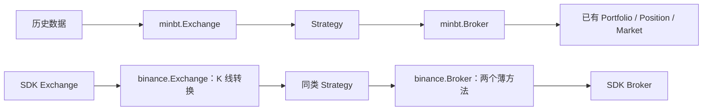

# 回测优先的最小实盘接入设计

日期：2026-10-23。第七版，依据 [GOAL.md](../../GOAL.md)、本轮用户要求和 `api-design-zh` 重写。
状态：**PLAN-072 已实现，已做源码审阅；按用户要求，代码认可后再测试**。以恢复到 `6c1e7a01c56578728bc44cf6e382659bac069a8f` 的代码为基线。
第六版及其未提交实现已保存到 [docs/ref/v1](../ref/v1/README.md)，不再作为后续实施要求。

2026-10-25 结构调整：Broker 与 Exchange 已按职责拆分，公开入口为 `binance.Broker/Exchange`，
历史读取器归入 `minbt.plugins.binance.feed`；目录与迁移见
[Binance 插件职责与命名整理](binance-20261025-layout.md)。下文单文件规模统计保留 PLAN-072 原始结果。

## 1. 定位与代码预算

minbt 首先是 mini、低认知负荷的 K 线回测库；实盘是通过外部 Binance2 Exchange/Broker 接入的附加能力。
用户仍只需理解 Exchange 提供行情、Broker 提供交易与查询、Strategy 保存参数并作决策。

**150 行是精简目标，不是硬性规定**（用户最新补充）。统计包含空行、注释、协议、适配层和核心新增/替换代码。
文档、测试不计；运行必需的辅助代码放在哪里都计入。不得压缩格式、动态生成方法，或向 SDK、基类、示例转移机制以规避预算。
以真实实现规模为准；必要的校验、资源清理和可读性优先于凑行数。

裁决顺序：回测主路径优先 → 复用 SDK → 低成本保留共同调用 → 昂贵的一致性公开放弃。
复杂度上升时先收缩实盘能力，不扩建共用运行框架。

保留 `from minbt import Exchange, Broker, Strategy`；不迁移 replay/sim，不弃用根入口。
回测保留现有同步市价撮合、目标单、分仓、退出规则、控制与 RunResult，不增加 legacy_immediate。
回测成交模型是否改进，应作为独立回测需求讨论。

## 2. 场景与首版范围

| 优先级 | 场景 | 决定 |
| --- | --- | --- |
| P0 | 自备 K 线回测、扫描参数、查看盈亏 | 保留现有完整主路径 |
| P0 | 回测多标的、目标仓位、分仓、退出规则 | 保留，实盘不强行对齐 |
| P0 | 自定义 Feed、Broker、Exchange | 协议与直接注入，不增加注册中心 |
| P1 | 单标的 K 线策略接 demo/实盘 | 一个 SDK 行情实例、一个账户、一个策略 |
| P1 | 复用有符号市价数量与持仓查询 | 两个薄适配方法，策略主体可复用 |
| P2 | 实盘限价、撤单、条件单、账户查询 | 直接使用 SDK 接口与返回值 |
| 暂不提供 | 实盘多标的截面、实时模拟、统一账户回调 | 首版只交付单标的闭合 K 线 |
| 暂不提供 | 自动恢复、保护托管、策略检查点、完整实盘绩效 | 不建立对应机制 |

首版面向低频、单标的、单向持仓。demo/mainnet 使用同一实现，由外部 SDK 构造参数选择。
不承诺重启续跑、自动接管或回测与实盘逐笔一致。

## 3. 先定义最小协议

选择 Protocol，不新增需要继承的 ExchangeBase、BrokerBase 或 Runtime。

```python
@runtime_checkable
class TradingBrokerProtocol(Protocol):
    def submit_market_order(self, symbol: str, qty: float) -> object: ...
    def get_position_size(self, symbol: str) -> float: ...


class StrategyExchangeProtocol(Protocol):
    def add_strategy(self, strategy) -> None: ...
    def get_current_dt(self) -> Optional[datetime]: ...
    def run(self) -> object: ...
```

以上列出共同调用的最小签名；实现可以有自己的可选参数。`qty` 都是买正卖负。
返回 `object` 是明确的能力边界：回测提交返回现有 Order，实盘提交返回 SDK 字典；回测 run 返回 RunResult，实盘返回 None。
协议不保证订单结构、成交时点和运行结果一致。持仓查询返回已知净数量，实盘查询可能阻塞网络。

现有 `BrokerProtocol` / `ReplayBrokerProtocol` 保持完整回测能力定义，仅做两处核心调整：

1. `Strategy.set_broker` 的标注与绑定检查改用 `TradingBrokerProtocol`。Strategy 保存引用，不要求实盘伪造分仓/退出方法。
2. 历史 `Exchange.run` 在占用实例、准备 Feed 和执行 on_init 前检查 `ReplayBrokerProtocol`，拒绝不具备回放推进能力的账户。

因此，完整回测账户的错误检查从 Strategy 构造移到历史运行入口；内置账户行为不变。
薄配置入口 `minbt.run` 已有 ReplayBrokerProtocol 校验，继续保留。
`StrategyExchangeProtocol` 用于类型说明，不增加 live 专属参数，不用运行时反射推断环境。

自定义实现可以直接遵循这些协议。Binance 接入不承担任意 Exchange 与任意 Broker 的自由组合。
不通过 `__getattr__`、空方法或一组 NotImplementedError 占位来伪装完整回测账户。

## 4. 用户接口

### 4.1 回测

```python
from minbt import Exchange, Broker, Strategy


class Pulse(Strategy):
    def on_init(self):
        self.previous = None

    def on_bars(self, dt, bars):
        bar = bars[self.params["symbol"]]
        rising = bar["close"] > bar["open"]
        if self.previous is not None and rising != self.previous:
            qty = self.params["qty"] if rising else -self.params["qty"]
            self.broker.submit_market_order(self.params["symbol"], qty)
        self.previous = rising


exchange = Exchange()
exchange.set_bars(prepared_rows)
exchange.add_strategy(Pulse("pulse", broker=Broker(initial_cash=10_000),
                            params={"symbol": "BTCUSDT", "qty": 0.001}))
result = exchange.run()
```

这是每次信号变化提交一次固定增量的接口示例，不是目标仓位或保护策略。
回测中的 target_*、分仓与退出条件继续正常使用。

### 4.2 实盘

用户所称 `finapi.binance2` 是外部行情/交易依赖。本机核实到的实际入口为 `crypto_api.binance2.usdm`，
相邻 finapi 未发现 binance2。示例使用实际路径，并取别名 binance2；换用其他包时先核对第 8 节 SDK 契约。

```python
import os
from crypto_api.binance2 import usdm as binance2
from minbt.plugins import binance


with binance.Exchange(symbol="BTCUSDT", interval="1m", environment="demo",
                   sdk_factory=binance2.Exchange) as exchange:
    with binance2.Broker(os.environ["BINANCE_API_KEY"],
                         os.environ["BINANCE_API_SECRET"],
                         exchange=exchange.sdk) as account:
        exchange.add_strategy(Pulse("pulse", broker=binance.Broker(account),
                                    params={"symbol": "BTCUSDT", "qty": 0.001}))
        exchange.run()
```

SDK Broker 通过 `exchange=exchange.sdk` 继承显式环境；不从密钥猜环境。
主网由调用者明确改为 mainnet。minbt 不接管密钥、不建立另一套真实账户、不增加实盘配置系统。
行情资源由 binance.Exchange 管理；账户由调用者的 SDK 上下文管理。工厂注入避免 minbt 绑定具体 SDK 包名或强制安装它。

### 4.3 实盘适配的完整接口

| 接口 | 行为 |
| --- | --- |
| `binance.Broker(sdk_broker)` | 借用 SDK 账户，`sdk` 显式提供原生能力，不负责关闭账户 |
| `submit_market_order(symbol, qty)` | 有限非零数量转 BUY/SELL 与正数 Decimal；同步调用一次 SDK，返回原始字典 |
| `get_position_size(symbol)` | 同步调用 SDK get_positions；仅接受单向 BOTH 仓位，返回净数量；双向/歧义记录报错 |
| `binance.Exchange(*, symbol, interval, environment, sdk_factory, max_delay=10.0)` | 创建未启动的 SDK 行情对象，绑定回调；单标的单周期，构造不联网 |
| `add_strategy(strategy)` | 绑定一个 Strategy 与 binance.Broker；重复绑定、已运行实例和其他账户类型在联网前拒绝 |
| `get_current_dt()` | 最近交付的 K 线收盘时间，启动前为 None；实际订单时间由 SDK/交易所提供 |
| `run()` | 启动 SDK 并阻塞等待；正常停止返回 None，异常保留 SDK 错误链 |
| `stop()` / `close()` / 上下文退出 | 停止未来策略交付、释放行情资源；不撤单、不平仓；close 可重复调用 |

高级操作直接使用 SDK，避免重新包装全部交易能力：

```python
order = self.broker.submit_market_order("BTCUSDT", 0.001)
current = self.broker.sdk.get_order("BTCUSDT", order_id=order["orderId"])
```

实盘适配下单不接受模拟专属 price、price_dt、逐单 leverage、portfolio 或退出参数。
精度/最小数量由 SDK 与交易所校验；不自动舍入或放大数量。参数检查失败不发送。
SDK 写调用异常时，薄 Broker 停止本实例后续适配下单并原样抛出，不将未知结果改成 rejected。

## 5. 内部核心概念与状态归属

除三个用户概念，适配仅需要当前闭合 K 线与运行状态，它们是普通数据/字段，不扩展成服务。

| 对象 | 最少状态 | 责任 |
| --- | --- | --- |
| Strategy | 参数、指标、业务状态 | 接收 K 线、调用交易，不自动保存检查点 |
| binance.Exchange | SDK 行情、一个策略、运行状态、最后收盘时间、当前回调线程标识 | 订阅、K 线转换、顺序交付、启停 |
| binance.Broker | SDK 账户引用、所属 Exchange、写请求失败标志 | 从所属 Exchange 检查标的与下单阶段，不复制许可或仓位状态 |
| SDK Exchange | 连接、订阅、队列、线程、失败传播 | 复用既有串行回调和有界队列 |
| SDK Broker / 交易所 | 请求、订单、持仓、条件单 | minbt 不复制账本或推导本地成交 |



两条运行循环各自独立，只共享低成本的策略回调形式与交易调用。
不增加 Runtime、BrokerSession、EventBus、StateStore、ProtectionManager、PersistentResult。

## 6. 内部流程与错误边界

### 6.1 回测

沿用基线：准备有限 Feed → on_init → 历史 TimeBatch → Broker 撮合/估值 → 按 control 调用策略 →
记录历史 → 冻结 RunResult → on_finish → 关闭 Feed。原撮合、只读阶段和异常语义不变。

### 6.2 实盘行情

```text
构造并绑定（不联网）
  → 标记实例已使用；登记连接回调与单标的订阅（SDK 此时只校验参数，不联网）
  → SDK 查询并确认单向持仓模式
  → on_init 初始化指标，适配下单关闭
  → 执行 SDK.run，启动连接和事件交付
  → SDK 固定回调线程逐项处理 events
  → 筛选闭合 K 线，检查标的/周期/年龄/连续性
  → on_bars(close_time, {symbol: bar})，仅回调期间允许适配下单
  → 返回 SDK，等待下一批
```

- 只交付 k.x=true；OHLCV 转有限 float，其他 K 线字段沿用历史 Feed 命名，时间为毫秒整数。
- 一个标的，无截面收齐；SDK 批次逐项处理，不视作同时间截面。
- 只保存最后 close_time，旧/重复收盘不再次回调。下一根 open_time 必须等于上一根 close_time + 1 毫秒，否则停止。
- 启动后的第一根闭合 K 线直接交付；指标预热由策略自备数据，不补发历史交易信号。
- 策略调用前检查 SDK received_at、交易所 E 和 K 线 close_time；超过 max_delay 或异常超前就停止，避免新消息携带旧 K 线触发交易。依赖部署时钟正常，不增加后台校时服务。
- on_bars 在 SDK 固定线程串行执行；on_init 在启动前、on_finish 在回调退出后执行，三者不并发。
- 适配下单同时检查当前线程是 on_bars 所在线程；策略自建线程不继承下单许可。持仓查询可在回调外调用。
- 不增加第二条队列、交易 worker 或私有账户流。交易/查询同步阻塞下一条策略处理；积压触发 SDK 有界队列错误或上述过期检查。

### 6.3 实盘交易

```text
策略给出 signed qty
  → 检查允许下单、有限非零数量、实例无写请求失败
  → Decimal(str(qty))，正负转 BUY/SELL
  → 同步 SDK.submit_market_order，一次调用
  → 返回原始响应；异常则禁止后续适配下单并抛出
```

回执不等于成交，仓位查询与订单响应也不构成原子事务。不根据响应自行扣费、加仓或生成 Fill。
不包装 target_*：未决订单、部分成交和仓位可见性需要额外协调，不能用“目标减当前仓位”冒充等价实现。
结果未知按 SDK 异常中的原标识查询，绝不自动重下。重启不恢复意图，调用者须先核实远端未决事项。
通过 broker.sdk 的直接调用由调用者负责，不受薄适配的下单许可/失败标志控制。

### 6.4 停止与故障

状态仅为 `created → running → stopped/failed`；关闭未运行实例也不可再运行。
stop 先关闭适配下单与策略交付，再请求 SDK.stop；排空期间的回调直接返回。
已通过本地准入检查的回调或同步请求仍可能开始/完成；stop 不作为跨线程等待屏障，不实现最终发送许可或耐久发送证明。
close 复用 SDK 的等待和幂等清理；SDK 回调内 close 只能请求停止，由外层 run 等待退出。
装配和 run 由调用者在同一控制线程顺序执行，不支持并发注册/启动；运行中可从回调或其他线程请求 stop/close。
构造参数和 sdk 关联在注册后不修改；直接驱动 exchange.sdk 的订阅、启动或关闭不属于适配生命周期。

SDK 通知 gap/断线/重连就结束本次运行，不补历史、不自动重新开放策略。
通知遵循 SDK 的交付顺序，不承诺在物理断线瞬间阻止先前已排队事件。
后台错误必须通过 SDK.run 传播；KeyboardInterrupt 也释放行情资源，不改写成成功结果。
正常停止且回调退出后调用 on_finish，适配下单保持关闭；异常不保证 on_finish，调用者用上下文释放资源。
清理失败在没有既有异常时传播；已有业务异常时保留原错误。重复 close 不重复释放资源，但 SDK 可能再次报告原后台错误。

| 情形 | 处理 |
| --- | --- |
| 参数错误、重复实例、错误账户组合 | 联网前 ValueError/TypeError/RuntimeError |
| SDK 拒绝、认证失败、限流、写结果未知 | 保留 SDK 类型和异常链，关闭适配下单，不重试、不伪造 Order |
| 缺口、过期行情、不支持的双向仓位 | 报错并结束，不猜测、不自动修复 |
| 用户捕获写异常后继续回调 | 后续适配下单仍拒绝，必须核实外部状态并换实例 |
| 查询失败 | 原样抛出，不用缓存或零掩盖；成功查询明确无仓位才返回零 |

单向模式在 run 的启动阶段通过 SDK get_position_mode 核实，避免空仓双向账户绕过查询检查。
实例只允许注册的 symbol 通过适配下单；绑定时要求 `broker.sdk.exchange is exchange.sdk`，
复用 SDK 已有的关联与环境校验，独立未关联账户不纳入首版。插件不读取 SDK 私有配置。

## 7. 有意保留的差异

| 项目 | 回测 | 实盘 | 理由 |
| --- | --- | --- | --- |
| 市价提交 | Order，既有同步成交模型 | SDK dict，请求同步、成交独立确认 | 省去统一订单状态/成交账本 |
| 持仓查询 | 本地 | 阻塞 REST | 省去账户投影和双源合并 |
| 目标仓位、分仓、自动退出 | 完整支持 | 不包装，高级操作用 SDK | 省去目标占用、保护托管与恢复 |
| 行情范围 | 既有多标的、多类数据 | 单标的闭合 K 线 | 省去截面聚合与多源时钟 |
| 控制 | continue/pause/exit、起止区间 | run/stop | 省去无行情轮询和控制器 |
| 结果 | RunResult、曲线、盈亏 | 正常 None，失败抛错 | 不构建实盘结果存储和完整核账 |
| Strategy 历史查询 | 正常采样 | 不采样，无法读取实盘历史 | 不扩改回测历史设施 |

仅依赖 on_bars、指标和固定数量下单的策略可复用；读取 Order 字段时改用 SDK 字段。
依赖 target_*、分仓、退出规则的策略需要修改交易部分，复杂策略不承诺稍改即可。
若扩大复用范围，先核算新增职责；精简实现与回测定位优先。

## 8. SDK 契约、文件与预算

SDK 行情工厂接受 on_data/environment；构造不联网，提供 subscribe/on_connection/run/stop/close。
同步回调串行执行，回调错误由 run 传播，close 等待已开始回调退出。
SDK 账户提供 submit_market_order(symbol, side, qty)、get_positions(symbol)、get_position_mode、公开 exchange 引用与订单查询。
参照本机 [SDK 指南](../../../crypto_api/docs/binance2/exchange-broker.md)，金额使用 Decimal/字符串，未知写结果不自动重发。
minbt 不修改 SDK，也不依赖旧版 send_permission 补丁。

```text
minbt/protocols/trading.py       # 两个最小 Protocol
minbt/strategy.py               # 仅调整 broker 绑定检查
minbt/exchange.py               # 回放入口检查 ReplayBrokerProtocol
minbt/plugins/binance/broker.py # 薄 Broker
minbt/plugins/binance/exchange.py # 薄 Exchange 与行情字段转换
```

PLAN-072 的实际统计（含空行与注释；核心按新增/替换行统计）：

| 部分 | 实际行数 |
| --- | ---: |
| 协议及导出 | 22 行 |
| 核心绑定与回放检查 | 11 行 |
| 单文件 live.py（Broker、Exchange、字段转换） | 186 行 |
| 总计 | 219 行 |

比最初 150 行估算多出的代码用于明确参数/绑定/线程检查、行情时效与连续性检查、异常后的禁写和资源清理。
没有新增服务、线程、队列、交易账本或 SDK 补丁。PLAN-076 已将原 live.py 拆分为
broker.py 与 exchange.py，共享时间转换来自 _kline.py；上述统计对应拆分前的 PLAN-072。
账户是借用资源，行情是自有资源；停止不改变远端仓位。适配自身状态 O(1)，SDK 队列边界由 SDK 配置负责。

## 9. 实施与后续验证

备份、回退和设计修订已完成；用户已要求实施，使用 PLAN-072，不继续 PLAN-070。
协议、隔离检查与薄适配已落地，[共用策略示例](../../examples/19_live.py) 展示回测与 demo 装配。
代码认可后验证回测行为、数量方向、闭合 K 线/去重/缺口、异常不重发、停止交付和资源释放即可。
使用 fake SDK，不依赖真实资金。旧恢复、保护和完整核账矩阵不再是本版待办。
